<div align="center">

<<<<<<< HEAD
# 💊 tujya-data

**Pipeline de collecte de données pour Tujya**

Prédire quelles combinaisons de médicaments agissent mieux ensemble sur des lignées de cancer,
en s'appuyant sur les données publiques et sur la littérature scientifique (PubMed).

`Python 3.11+` · `FastAPI` · `React` · `Parquet` · `Licences vérifiées`

🏫 TEK-UP University · 👥 **Équipe : Mohamed Raed Bouhali · Ilef Ben Hassen · Melek Bouabid**

</div>

> [!NOTE]
> Le pipeline collecte uniquement des données scientifiques **publiques**, de façon polie et reproductible :
> **API officielles d'abord**, fichiers officiels ensuite, **jamais de scraping HTML**.
> Ce n'est pas un scraper généraliste : il refuse de contacter tout site qui n'est pas dans sa liste de sources.

---

## 📑 Sommaire

| | Section | | Section |
|---|---|---|---|
| 🧱 | [Architecture](#architecture) | 🌐 | [Comportement réseau](#comportement-reseau) |
| 📦 | [Ce que vous obtenez](#ce-que-vous-obtenez) | ⏰ | [Planification et Docker](#planification-et-docker) |
| ⚙️ | [Installation](#installation) | 🖥️ | [Application web](#application-web) |
| ▶️ | [Utilisation](#utilisation) | 🛠️ | [Développement](#developpement) |
| 📚 | [Sources](#sources) | 🗂️ | [Structure du dépôt](#structure-du-depot) |

---

<a id="architecture"></a>

## 🧱 Architecture

Le projet a **trois couches**. Chacune lit uniquement la sortie de la précédente.

| Couche | Dossier | Rôle |
|---|---|---|
| 1️⃣ Pipeline de données | `src/tujya_data/` | Collecter, valider et nettoyer les données dans `data/` |
| 2️⃣ Application web | `backend/` et `frontend/` | Lire les tables de `data/parquet` et les servir avec comptes et rôles |
| 3️⃣ Modélisation 🟡 *prévue* | à venir | Entraîner et comparer les modèles sur les mêmes tables |

### 🔭 Vue d'ensemble

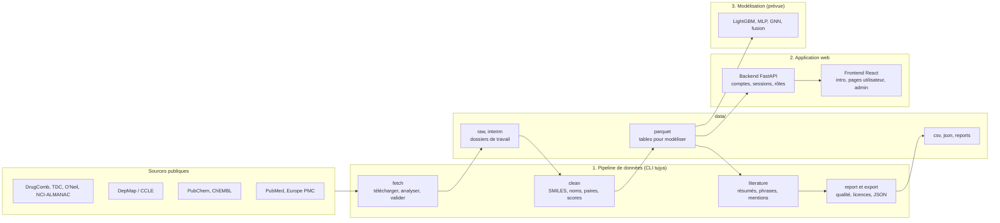

<a id="schema-pipeline"></a>

### 🔄 Le pipeline en 5 étapes

`fetch` travaille par étapes, car chaque étape a besoin du résultat de la précédente.

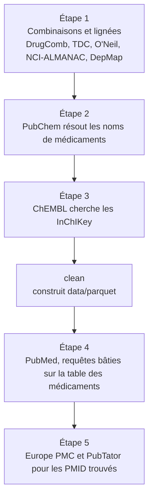

Dans chaque connecteur, les mêmes quatre étapes s'exécutent : `discover` → `fetch` → `parse` → `validate`.
Les fichiers bruts ne sont **jamais modifiés** ; le manifeste garde le SHA-256, la taille, l'URL, la version et la licence.

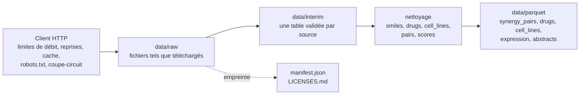

<a id="schema-application"></a>

### 🖥️ Application web

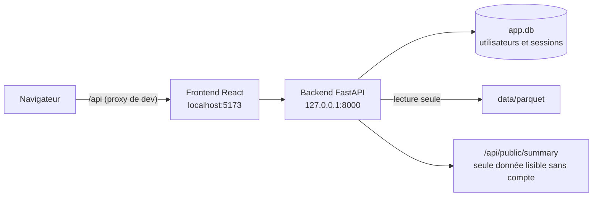

| Partie | Responsabilité |
|---|---|
| 🌍 Page d'introduction publique | Affiche seulement la taille des tables, sans compte |
| 🔐 Connexion / inscription | Un nouveau compte est toujours un utilisateur simple |
| 👤 Pages utilisateur (`/home`) | Accueil, médicaments, lignées, profil |
| 🛡️ Pages admin (`/admin`) | Tableau de bord, création d'administrateurs, rôles, mots de passe, désactivation et suppression |
| 🍪 Session | Cookie `HttpOnly` lié à une ligne en base : désactiver un compte le déconnecte aussitôt |
| ✅ Autorisation | Le rôle est vérifié par l'API à chaque requête |

### 🧠 Couche de modélisation 🟡 *prévue*

> [!WARNING]
> Cette couche **n'existe pas encore** dans ce dépôt. Elle lira `data/parquet` et comparera quatre modèles sous trois protocoles de validation, pour isoler l'effet de la littérature.

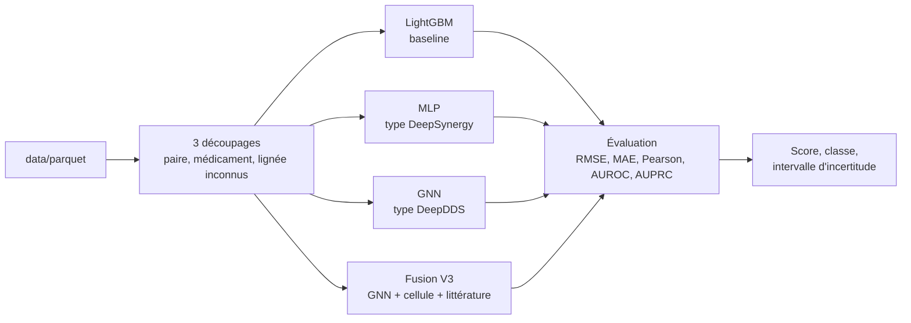

| Version | Entrées | Question posée |
|---|---|---|
| **V1** | Chimie seule | Que vaut la structure moléculaire seule ? |
| **V2** | Chimie + lignée | Qu'apporte le profil de la cellule ? |
| **V3** 🔬 | Chimie + lignée + littérature | **Les connaissances PubMed aident-elles, surtout pour un médicament jamais vu ?** |

La différence **V3 − V2**, répétée sur plusieurs graines, est le résultat scientifique principal.
Positif, nul ou négatif : tout est acceptable s'il est rapporté avec des chiffres.

> [!CAUTION]
> Les prédictions sont des **hypothèses in silico** à valider en laboratoire. Ce n'est jamais un conseil médical.

---

<a id="ce-que-vous-obtenez"></a>

## 📦 Ce que vous obtenez

Tout ce que produit le pipeline est dans **un seul dossier**, `data/`, avec un sous-dossier par format.
L'extension du fichier indique où il se trouve.
=======
# 💊 Tujya

**Scan your pills, check their interactions, ask questions and get cited answers**

Pill detection and identification from a photo, drug–drug interaction checks with DDInter,
and a RAG agent that answers follow-up questions with its sources.

`Python` · `FastAPI` · `React 19` · `YOLO11` · `ONNX Runtime` · `LangGraph` · `ChromaDB` · `Ollama` · `MLflow` · `DVC` · `Docker Compose`

🏫 TEK-UP University · 👥 **Team: Mohamed Raed Bouhali · Ilef Ben Hassen · Melek Bouabid**

</div>

> [!CAUTION]
> **For information only.** Tujya does not replace a pharmacist or a doctor. It never gives a
> dose and never says a combination is "safe": at best it says "no known interaction in this
> database".

> [!NOTE]
> **Status on 2026-11-01.** The project moved to a second PC (RTX 4050 Laptop, 6 GB). The
> missing data was rebuilt from the public sources and the three models were retrained with
> their original settings: their test scores are within about one point of the original ones.
> Details: [restoration report](docs/rapports/restauration_2026-11-01/rapport_restauration_2026-11-01.md).

---

## 📑 Contents

| | Section | | Section |
|---|---|---|---|
| 🧭 | [How it works](#how-it-works) | 💾 | [Data, DVC and models](#data-dvc-models) |
| 🧱 | [Architecture](#architecture) | 📚 | [Data sources](#data-sources) |
| ✨ | [Features](#features) | 🔒 | [Strictly local usage](#strictly-local) |
| 🤖 | [The chat agent](#chat-agent) | 🔑 | [Accounts and security](#accounts-security) |
| ✅ | [Module requirements](#requirements) | 🛠️ | [Development and tests](#development) |
| 🚀 | [Quick start](#quick-start) | 📖 | [Documentation](#documentation) |
| 📊 | [Results](#results) | 📝 | [Progress log](#progress-log) |
| 🧪 | [Bonus: toxicity](#bonus-toxicity) | 🧬 | [Appendix: SynergyRx data pipeline](#synergyrx-pipeline) |
| 🗂️ | [Repository layout](#repository-layout) | 👥 | [Team](#team) |

---

<a id="how-it-works"></a>

## 🧭 How it works

You photograph one or more pills (upload or webcam). A YOLO model **detects** each pill, then
a classifier trained by *transfer learning* **identifies** it among a closed list of 150 pills
from the public NLM C3PI dataset. Each pill is linked to its active ingredient(s), and Tujya
checks the **interactions** between those ingredients in DDInter. A LangGraph agent then
answers follow-up questions with RAG (openFDA labels, PubMed abstracts, DDInter), **citing its
sources**. The result can be kept in a signed **report**, printed on one A4 page or shared
read-only with a pharmacist.

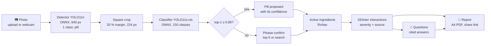

---

<a id="architecture"></a>

## 🧱 Architecture

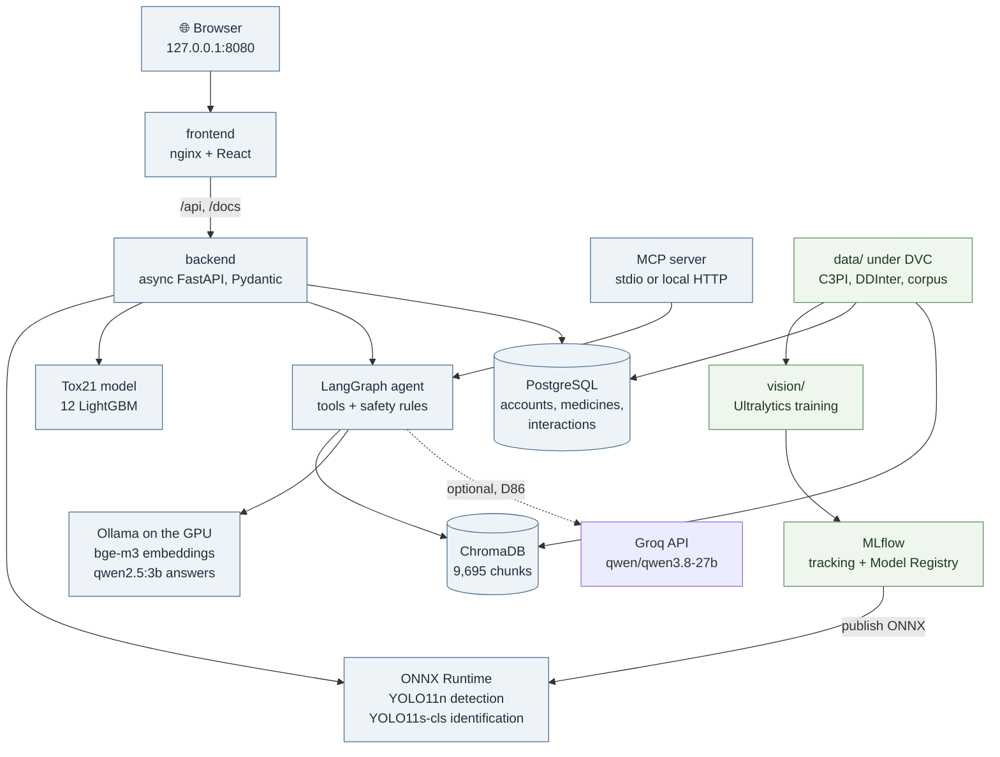

| Component | Technology | Address (Docker) | Role |
|---|---|---|---|
| 🌐 Website | React 19, Vite 8, three.js 0.186 | `127.0.0.1:8080` (nginx) | Pages, Scanner, chat panel, reports |
| ⚙️ Backend API | FastAPI, Pydantic | `127.0.0.1:8000`, Swagger at `/docs` | Accounts, scan, interactions, chat, toxicity, reports |
| 👁️ Pill models | ONNX Runtime (CPU) | inside the API | Detection and identification |
| 🗄️ Database | PostgreSQL 16 | `127.0.0.1:5432` | Accounts, medicine tables, MLflow store |
| 🔎 Vector index | ChromaDB 1.5.9 | `127.0.0.1:8001` | Search over 9,695 chunks |
| 🧠 Local LLM and embeddings | Ollama | `127.0.0.1:11434` | bge-m3 embeddings; qwen2.5:3b answers |
| 📈 Experiment tracking | MLflow 3.17.2 | `127.0.0.1:5000` | Training runs and Model Registry |

---

<a id="features"></a>

## ✨ Features

| Page | What it does |
|---|---|
| 📷 **Scanner** (`/scan`) | Upload, webcam (live predictions) or demo gallery; boxes and top-5 for each pill, confirmation asked below the 0.85 threshold; "My pills" kept in the account (10 at most); from 2 pills, DDInter interactions sorted by severity, with their sources |
| 💬 **Chat** "Ask about your pills" (under the Scanner) | LangGraph agent: streamed answer, clickable numbered citations, visible tool calls; dose questions refused; a greeting or an off-topic question gets a short answer labelled "general knowledge" (D84) |
| 📄 **Reports** (`/reports`) | Re-checks the interactions and keeps the ticked chat answers, sealed (HMAC-SHA256) so they cannot be edited; signed with the profile signature; printed as A4 or PDF; read-only share link for 1 to 30 days, no account needed (`/shared`) (D83) |
| 🧪 **Toxicity** (`/toxicity`) | Tox21 prediction for one or two molecules ([bonus](#bonus-toxicity)) |
| 🧬 **Drugs**, **Cell lines** | Tables inherited from SynergyRx (`data/parquet`); the Scanner, interactions and chat do not depend on them |
| 🛡️ **Administration** (`/admin`) | Accounts; activity log (counts only, never a medicine name or the text of a question; kept 180 days, D82); usage report with daily charts; CSV exports (D83) |
| ℹ️ **About**, **Privacy**, **Help** | Public pages: the project, what is stored and who sees it, frequent questions |

🌍 The interface is in English, French and Russian, with a light or dark theme (D81). The
safety texts stay in French in every language.

---

<a id="chat-agent"></a>

## 🤖 The chat agent

A LangGraph graph with a bounded loop (2 rounds at most, D77). Rules plan the first round
when the question names known drugs, so most questions need a single LLM call (D78).

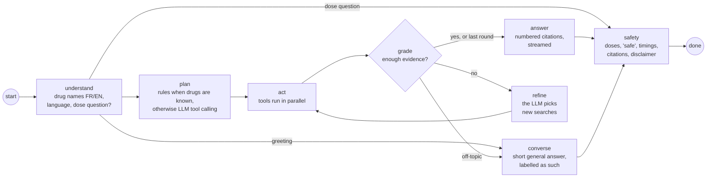

| 🧰 Tool | What it returns |
|---|---|
| `check_interaction` | DDInter severity, description and source for each pair |
| `get_drug_info` | Sections of the openFDA label (contraindications, warnings, mechanism, ...) |
| `search_documents` | Dense search over labels, abstracts and DDInter rows, filtered by ingredient |
| `predict_toxicity` | Tox21 assay probabilities for a molecule |
| `identify_pills` | MCP server only: identify the pills in an image |

🛡️ **Safety rules**, applied to every answer:

1. A dose question is refused before any model call; a sentence giving an amount is removed.
2. No "safe" or "no risk" claim, no timing that is not in a source, never "non-toxic".
3. When no interaction is found: "no known interaction in this database", never "safe together".
4. Every citation must point to a numbered source; the others are removed.
5. Every answer ends with the disclaimer.

The same tools are exposed by an MCP server (official Python SDK, stdio or HTTP):
[docs/MCP.md](docs/MCP.md). Details of the graph: [docs/AGENT.md](docs/AGENT.md).

---

<a id="requirements"></a>

## ✅ Module requirements

A box is ticked only when the requirement is actually met.

### 👁️ Module 1: Industrialisation, Vision & MLOps

- [x] Vision: pill detection with YOLOv8/v11
- [x] Vision: identification of each pill by transfer learning
- [x] Async FastAPI backend, Pydantic schemas, Swagger at `/docs`
- [x] React frontend: image upload, webcam, predictions and bounding boxes
- [x] DVC (data versioning)
- [x] MLflow: experiment tracking
- [x] MLflow: Model Registry
- [x] ONNX export and ONNX Runtime inference
- [x] Docker Compose
- [x] GitHub Actions CI/CD
- [ ] Practical defence (live technical demo)

### 🧠 Module 2: AI Engineering

- [x] RAG with document management, metadata, citations, documentation
- [x] Tool calling / MCP
- [x] LangChain and/or LangGraph
- [x] Retrieval and generation benchmarking
- [x] Web interface
- [x] Documented GitHub repository with regular commits
- [x] Technical report ([module 2](docs/rapports/rapport_module2_ai_engineering.pdf); also [module 1](docs/rapports/rapport_module1_vision_mlops.pdf))
- [ ] Demo

---

<a id="quick-start"></a>

## 🚀 Quick start

### 🐳 With Docker (the whole application)

PostgreSQL, ChromaDB, MLflow, Ollama on the GPU, API, agent and website start with one
command, from the root of the repository:

```bash
docker compose up -d --build
```

| What | Address |
|---|---|
| 🌐 Website | <http://localhost:8080> (demo account `user@gmail.com` / `user`, then "Scanner" and the "Ask about your pills" panel at the bottom) |
| 📘 Swagger | <http://localhost:8080/docs> |
| 📈 MLflow | <http://localhost:5000> |

- If port 8080 is taken: `WEB_PORT=8081 docker compose up -d`.
- On the first start, `rag-init` pulls the Ollama models (qwen2.5:3b, bge-m3), then indexes
  the corpus `data/rag/corpus` (DVC) into ChromaDB (service `chroma`).
- Administrator account: `admin@gmail.com` / `admin`. **Change this password** before any
  demo (Admin, then My account).

> [!IMPORTANT]
> Before the first start, you need the data under `data/` (DVC, see
> [Data, DVC and models](#data-dvc-models)) and the models in `models/`
> (`cd vision && python -m tujya_vision.publish`, from the MLflow Model Registry). Neither is
> in git. Details: [docs/INFRA.md](docs/INFRA.md); API: [docs/API.md](docs/API.md).

### 💻 Without Docker (development)

The API then reads the medicine tables from SQLite (`data/tujya.db`) and the index from a
local ChromaDB folder (`data/rag/chroma`). Ollama must run on `127.0.0.1:11434` with
`qwen2.5:3b` and `bge-m3`.

```bash
# Once, in backend/ (backend venv):
python -m app.pharma_loader    # medicine tables -> data/tujya.db
python -m app.rag.index        # corpus data/rag/corpus -> data/rag/chroma

# Terminal 1: API on http://127.0.0.1:8000 (Swagger at /docs)
cd backend
python -m venv .venv
.venv\Scripts\Activate.ps1           # Linux / macOS: source .venv/bin/activate
pip install -r requirements-dev.txt
uvicorn app.main:app --host 127.0.0.1 --reload

# Terminal 2: website on http://127.0.0.1:5173
cd frontend
npm install
npm run dev
```

The Vite dev server forwards `/api`, `/docs` and `/openapi.json` to the backend, so the
browser talks to a single origin (the old address `/api/docs` redirects to `/docs`). MLflow
is only needed to train or publish a model: `docker compose up -d postgres mlflow`.

### 🎤 For the defence

- **Demo script:** [docs/DEMO.md](docs/DEMO.md); likely jury questions:
  [docs/QUESTIONS_JURY.md](docs/QUESTIONS_JURY.md); last session report:
  [docs/SESSION_REPORT_4.md](docs/SESSION_REPORT_4.md).
- Step-by-step walkthroughs: [docs/SESSION_REPORT_2.md](docs/SESSION_REPORT_2.md) (scan) and
  [docs/SESSION_REPORT_3.md](docs/SESSION_REPORT_3.md) (agent); screenshots:
  [docs/screenshots/](docs/screenshots/).

---

<a id="results"></a>

## 📊 Results

### 👁️ Vision (module 1)

Test split (photos never seen in training). The models in service are the ones retrained on
2026-11-01 (`tujya-pill-classifier` v1 and `tujya-pill-detector` v1 in the MLflow of the
current PC); details: [docs/VISION.md](docs/VISION.md) and the
[restoration report](docs/rapports/restauration_2026-11-01/rapport_restauration_2026-11-01.md#5-pill-recognition-data-and-training).

| Measure | Original (RTX 2050, 2026-10-28) | Retrained (RTX 4050, 2026-11-01) |
|---|---:|---:|
| Identification (YOLO11s-cls): top-1 | 93.5 % | **93.9 %** |
| Identification: top-5 | 98.1 % | **97.6 %** |
| Detection (YOLO11n): mAP50 | 0.972 | **0.970** |
| Detection: mAP50-95 | 0.861 | **0.850** |
| Detection: precision / recall | 0.957 / 0.936 | **0.942 / 0.951** |

> [!NOTE]
> The test photos show the same physical pills as the training photos, and the detector is
> scored against automatic boxes (about 90 % correct): on new pills the scores would be lower.

### 🔎 RAG (module 2)

Details, limits and commands: [docs/BENCHMARK.md](docs/BENCHMARK.md) and
[docs/RAG.md](docs/RAG.md#chromadb-run-2026-11-01). Every run is in MLflow (experiment
`tujya-rag`).

**Retrieval**, measured on 2026-11-01 on the current corpus (ChromaDB, 9,695 chunks, D85
chunking): 80 questions (41 FR, 39 EN), 75 of them with expected chunks, top 10.

| Retrieval (ingredient filter) | Recall@1 | Recall@5 | Recall@10 | MRR |
|---|---:|---:|---:|---:|
| BM25 | 0.600 | 0.773 | 0.867 | 0.674 |
| hybrid (RRF) | 0.747 | 0.933 | 0.973 | 0.838 |
| **dense (bge-m3), chosen** | **0.800** | **0.920** | **0.947** | **0.856** |

**Agent**, measured on 2026-11-01 on the same 80 questions (local qwen2.5:3b, RTX 4050,
before D85 and D86):

| Agent | Result |
|---|---:|
| ⚡ First words on screen (median) | 0.49 s |
| ⏱️ Whole answer: median / 90th percentile | 2.54 s / 5.19 s |
| LLM calls per question | 1.01 |
| An expected chunk among the numbered sources | 97.3 % |
| Sentences with a citation | 73.5 % |
| Numeric doses / "safe" / unsourced timings | 0 / 0 / 0 |
| Disclaimer present; dose questions refused | 100 %; 2/2 |

**Generation**, measured on 2026-10-28 on the previous corpus (8,661 chunks, 88 questions,
qwen2.5:3b, judge gemma3:4b). Not yet measured again on the current corpus (gemma3:4b is not
on this PC) or with Groq (D86):

| Generation | Result |
|---|---:|
| Cited sentences supported by their source | 94.0 % |
| Sentences with a citation | 69.8 % |
| Numeric doses / "safe" in the answers | 0 / 0 (and 4 adjustment advices without a number; rule extended since) |
| RAGAS (8 questions): faithfulness / relevancy / context precision | 0.979 / n/a / 0.809 |
| Mean answer time (RTX 2050) | 4.7 s |

---

<a id="bonus-toxicity"></a>

## 🧪 Bonus: toxicity tool (Tox21)

Tool `predict_toxicity` (agent, MCP server, `POST /api/toxicity`, **Toxicity** page of the
site): for one or two molecules (ingredient name or SMILES), the probability of activity in
the 12 Tox21 in vitro assays, **"a model's prediction on in vitro assays, not a clinical
assessment"**. Each molecule is predicted on its own; nothing is said about their
combination. Details: [docs/TOXICITY.md](docs/TOXICITY.md).

- 📦 **Data:** Tox21 (MoleculeNet / DeepChem copy, 7,831 molecules), versioned by DVC; no
  explicit licence found (public data of US federal agencies, cited, not redistributed, D73).
- 🌲 **Model:** Morgan fingerprints (RDKit, radius 2, 2,048 bits), one LightGBM per assay,
  **scaffold split** (6,258 / 782 / 783); mean test ROC-AUC **0.725** (0.647 to 0.822 by
  assay), 0.766 on validation; MLflow `tujya-tox`, registered model `tujya-tox21` (v2 on the
  original PC; retrained on 2026-11-01 on the current PC, v1, same mean ROC-AUC).
- ✍️ In the chat, the sentences about the prediction are written by code from the tool's
  result (the 3B LLM misread the probabilities, D74); new rule: never "non-toxic".
- 🧬 **Synergy (DrugComb):** studied but **not turned into a tool**: the rule fixed before
  training (RMSE at least 10 % below the mean and r ≥ 0.3, split by drug) is not met
  (−7.3 %, r 0.377); details: [docs/SYNERGY.md](docs/SYNERGY.md).

---

<a id="strictly-local"></a>

## 🔒 Strictly local usage

Tujya runs **only on this PC**: no public deployment, no tunnel, no published Docker image of
the application, no service bound to `0.0.0.0` on the machine. The GitHub repository stays
public (code and documentation only).

- 🔌 Every port published by Docker Compose is bound to `127.0.0.1` (postgres 5432, mlflow
  5000, chroma 8001, backend 8000, ollama 11434, site 8080): checked with `netstat`, these
  ports refuse connections from the PC's local network address.
- 🧑‍💻 Development servers: Vite on `127.0.0.1:5173`, uvicorn with `--host 127.0.0.1`, HTTP MCP
  server limited to `127.0.0.1` / `localhost` / `::1`.
- 📋 Details and checks: [docs/INFRA.md](docs/INFRA.md#strictly-local-usage-since-2026-10-28).

> [!WARNING]
> **Intended exception (D86).** With `SYNERGYRX_LLM_PROVIDER=groq` in `backend/.env`, the
> question, the confirmed pills and the retrieved passages are sent to the Groq API to write
> the answer. Photos, documents, embeddings and the index stay on this PC. Without that line
> (or when Groq fails), the local Ollama model answers and nothing leaves the PC.

---

<a id="data-dvc-models"></a>

## 💾 Data, DVC and models

The data (C3PI images and metadata, DDInter tables, RAG corpus, Tox21, SynergyRx tables in
`data/parquet`, outputs of the `prepare` and `rag_corpus` stages) is never in git: only the
DVC pointers (`data/**/*.dvc`, `dvc.lock`) are committed. The models served by the API
(`models/`) and the MLflow history (`mlruns/`, `mlartifacts/`) are not in git either.

### 🏋️ From images to served models

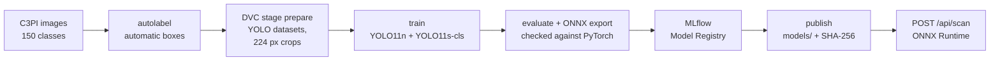

### 📚 From sources to the search index

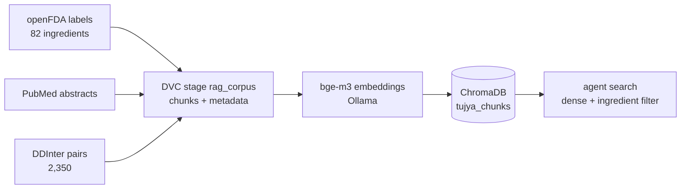

### ☁️ DVC remote

> [!WARNING]
> **No remote is configured** (`.dvc/config` is empty). The original backup folder (D71) was
> deleted (D80); the data was rebuilt on 2026-11-01 with the project's own pipeline and exists
> only on the PC that rebuilt it.

For a new clone to get the data, declare a remote on that PC and push the cache to it:

```bash
dvc remote add -d --local localstore <storage-folder>
dvc push                 # from the PC that has the data
dvc pull                 # in a new clone
dvc status -c            # are the cache and the remote in sync?
```

To move to Google Drive or S3 later (commands only, nothing is configured):

```bash
dvc remote add gdrive gdrive://<folder-id> && dvc remote default gdrive && dvc push
dvc remote add s3store s3://<bucket>/tujya && dvc remote modify --local s3store profile <aws-profile>
dvc remote default s3store && dvc push
```

🔐 Credentials always go in `.dvc/config.local` (ignored by git); the data must stay private
(C3PI and DDInter licences). Details: [docs/INFRA.md](docs/INFRA.md#dvc-remote-since-2026-10-28).

---

<a id="data-sources"></a>

## 📚 Data sources

| Dataset | Link | Licence | Use in Tujya |
|---|---|---|---|
| **NLM C3PI** (Computational Photography Project for Pill Identification) | [catalog.data.gov](https://catalog.data.gov/dataset/computational-photography-project-for-pill-identification-c3pi), [files](https://data.lhncbc.nlm.nih.gov/public/Pills/) | ODbL; research and development use only | Pill images ("consumer" photos and reference images) for detection and identification; metadata (NDC, name, ingredient) |
| **ePillID** | [arXiv:2005.14288](https://arxiv.org/abs/2005.14288) | paper (benchmark built on C3PI) | Reference benchmark to compare identification |
| **DDInter 2** | [ddinter2.scbdd.com](https://ddinter2.scbdd.com/) | CC BY-NC-SA 4.0 (non-commercial academic use) | Interactions between ingredients: severity, description |
| **RxNorm / RxNav** (NLM) | [lhncbc.nlm.nih.gov/RxNav](https://lhncbc.nlm.nih.gov/RxNav/APIs/) | UMLS / RxNorm terms of use (public API) | NDC / name -> active ingredient(s) when the C3PI metadata is not enough |
| **openFDA drug labels** | [open.fda.gov/apis/drug/label](https://open.fda.gov/apis/drug/label/) | CC0 / public domain (openFDA terms) | RAG corpus: official labels, with metadata and citations |
| **PubMed** (E-utilities) | [ncbi.nlm.nih.gov/books/NBK25501](https://www.ncbi.nlm.nih.gov/books/NBK25501/) | NLM terms | RAG corpus: article abstracts |
| **Tox21** (MoleculeNet / DeepChem copy) | [tox21.csv.gz](https://deepchemdata.s3-us-west-1.amazonaws.com/datasets/tox21.csv.gz) | no explicit licence found (D73) | Toxicity bonus: training data |

> [!IMPORTANT]
> Data is never committed to git (several sources forbid redistribution): it lives under
> `data/`, versioned with DVC. The sources of the earlier SynergyRx pipeline are described in
> the [appendix](#synergyrx-pipeline).

---

<a id="accounts-security"></a>

## 🔑 Accounts and security

The first start creates two accounts (in PostgreSQL with Docker, in `backend/app.db` without):

| Email | Password | Lands on |
|---|---|---|
| `admin@gmail.com` | `admin` | `/admin`: dashboard, user management, activity log, usage report |
| `user@gmail.com` | `user` | `/home`: home page, Scanner and chat, reports, toxicity, drugs, cell lines, profile |

> [!CAUTION]
> **Change the administrator password before anyone else can reach the server** (Admin, then
> My account). The API prints a warning at every start until you do. To start with other
> credentials, copy `backend/.env.example` to `backend/.env` before the first start.

- 👥 Anyone can sign up; a new account is always a regular user. Only an administrator can
  create administrators, change roles, reset passwords, deactivate or delete accounts.
- 👀 Administrators see what every account does under Admin > Activity: sign-ins and failed
  sign-ins, scans, interaction checks, questions, toxicity predictions, profile changes and
  other administrators' actions, with the time, browser and address. Only counts are kept,
  never a medicine name or the text of a question; events older than 180 days are deleted at
  start-up (`SYNERGYRX_ACTIVITY_RETENTION_DAYS`).
- 🔒 Passwords are stored as Argon2 hashes: they can be replaced, never read back. At least 8
  characters.
- 🍪 The session is an `HttpOnly` cookie backed by a database row, so resetting a password or
  deactivating an account signs that user out immediately.
- 🔗 A share link holds a 192-bit token shown once; only its SHA-256 is stored. Only the owner
  reads their medicines and reports; administrators never do.
- ✅ The role is checked by the API on every request; hiding a page in the frontend is only
  for convenience.

---

<a id="development"></a>

## 🛠️ Development and tests

| Part | Command | Last run (2026-11-08) |
|---|---|---|
| 🧬 Pipeline | `python -m pytest tests/unit` (root, `.venv-dev`) | ✅ 292 passed |
| ⚙️ Backend | `python -m pytest` in `backend/` (fake ONNX models, temporary databases, fake LLM) | ✅ 181 passed |
| 🌐 Frontend | `npm run build` in `frontend/` (type check and production build) | |
| 👁️ Vision | `python -m pytest` in `vision/` (no training) | |

```bash
make check        # pipeline: lint, type check, unit tests (mocked HTTP, no network)
make live         # optional smoke tests against the real services, tiny samples
pre-commit install
```

Without `make` (plain Windows): `python -m ruff check src tests`, `python -m mypy`,
`python -m pytest tests/unit`, `python -m pytest tests/live -m live`.

🤖 **CI** (`.github/workflows/ci.yml`): 4 jobs (pipeline, backend, vision, frontend), no live
network test. **CD** (`.github/workflows/cd.yml`): after a green CI on `main`, builds and
smoke-tests the backend and frontend images **without pushing them** (D70, [docs/CD.md](docs/CD.md)).

---

<a id="documentation"></a>

## 📖 Documentation

| Topic | Document |
|---|---|
| 👁️ Vision: data, labelling, training, ONNX | [docs/VISION.md](docs/VISION.md), [docs/DATASET_C3PI.md](docs/DATASET_C3PI.md) |
| ⚙️ API | [docs/API.md](docs/API.md) |
| 💊 Ingredients and interactions | [docs/INTERACTIONS.md](docs/INTERACTIONS.md) |
| 🔎 RAG corpus and search | [docs/RAG.md](docs/RAG.md) |
| 🤖 Agent and MCP server | [docs/AGENT.md](docs/AGENT.md), [docs/MCP.md](docs/MCP.md) |
| 📊 Benchmark | [docs/BENCHMARK.md](docs/BENCHMARK.md) |
| 🧪 Toxicity and synergy bonuses | [docs/TOXICITY.md](docs/TOXICITY.md), [docs/SYNERGY.md](docs/SYNERGY.md) |
| 🐳 Infrastructure, CD | [docs/INFRA.md](docs/INFRA.md), [docs/CD.md](docs/CD.md) |
| 🎤 Demo and jury questions | [docs/DEMO.md](docs/DEMO.md), [docs/QUESTIONS_JURY.md](docs/QUESTIONS_JURY.md) |
| 🧭 Decisions and roadmap | [docs/DECISIONS.md](docs/DECISIONS.md), [docs/ROADMAP.md](docs/ROADMAP.md) |
| 📑 Reports (PDF) | [module 1](docs/rapports/rapport_module1_vision_mlops.pdf), [module 2](docs/rapports/rapport_module2_ai_engineering.pdf), [restoration](docs/rapports/restauration_2026-11-01/rapport_restauration_2026-11-01.pdf) |

---

<a id="progress-log"></a>

## 📝 Progress log

<details>
<summary><b>📅 Every task, from the first commit to today (click to open)</b></summary>

| Date | Task | What was done | Files | Results |
|---|---|---|---|---|
| 2026-10-26 | Initial commit (`9398f0c`) | Imported the SynergyRx pipeline, the FastAPI backend, the React frontend (Tujya brand) and the Tujya plan | whole repository | 270 pipeline unit tests; backend with accounts, sessions, admin, catalog |
| 2026-10-27 | Task 1: README and project rules | Tujya presentation, module requirements, data sources, log; mandatory session rules in CLAUDE.md; new data direction (C3PI, no personal photos, two stages detection + identification, ePillID, openFDA) | `README.md`, `CLAUDE.md`, `docs/ROADMAP.md`, `docs/DECISIONS.md`, `docs/NIGHT_REPORT.md` | Documentation up to date; no requirement ticked (none met yet) |
| 2026-10-28 | Task 2: exploring C3PI | Downloaded `sampleData.zip` (517 MB) and the 110 metadata XML files; `vision/tujya_vision` tool (image index, selection, SHA-1-checked download); full dataset documentation | `docs/DATASET_C3PI.md`, `vision/tujya_vision/c3pi.py`, `vision/tujya_vision/data_cli.py`, `vision/tests/test_c3pi.py` | 133,458 files; 40,587 "consumer" photos of 2,400 pills; 380 pills have at least 20 photos; no bounding boxes or masks for consumer photos, alpha masks in the segmented reference images; 8 tests |
| 2026-10-28 | Task 3: training subset | 150 classes (pill = NDC9 + part) ranked by number of consumer photos, without the Canon G10 and Nikon S3000 cameras (too heavy for the bandwidth); up to 30 photos per class + 1 RxNav reference image per NDC; SHA-1-checked download; per-photo 70/15/15 split stratified by class; DVC initialised, images and metadata tracked (no remote yet) | `config/pill_classes.csv`, `config/splits/selected_images.csv`, `data/vision/c3pi/images.dvc`, `data/vision/c3pi/metadata.dvc`, `.dvc/`, `vision/requirements.txt` | 4,206 files (4.8 GB), 24 to 30 photos per class, 3,006 train / 600 val / 600 test, 0 download failures; DVC local only: DVC box not ticked until a remote is configured |
| 2026-10-28 | Task 4: ingredients and interactions | Active ingredients through RxNav (NDC -> RxCUI -> base ingredients, no strength); existing DDInter connector enabled by a Tujya step (CC BY-NC-SA terms accepted, 14 ATC files instead of 8); 3 name aliases; clean interaction tables (pair, severity, description, source) tracked by DVC | `src/synergyrx_data/tujya/`, `tests/unit/test_tujya.py`, `config/ingredient_aliases.csv`, `docs/INTERACTIONS.md`, `data/tujya.dvc` | 149/150 classes mapped (82 ingredients; only the multivitamin has none); 82/82 found in DDInter; 2,350 pairs between classes (125 Major, 826 Moderate, 72 Minor, 1,327 Unknown); 40,508 pairs with any drug; 279 pipeline tests pass |
| 2026-10-28 | Task 5: infrastructure | `docker-compose.yml`: PostgreSQL 16 + pgvector and MLflow 3.17.2 server (PostgreSQL store, artefacts in a volume); SQL schema (sources, pills, ingredients, pill_ingredients, interactions) in SQLAlchemy, separate from `app.db`; idempotent loader + tests | `docker-compose.yml`, `docker/`, `backend/app/pharma.py`, `backend/app/pharma_loader.py`, `backend/tests/test_pharma.py`, `docs/INFRA.md` | Containers up (postgres healthy, MLflow /health = 200); loaded into PostgreSQL: 150 pills, 1,716 ingredients, 161 links, 40,508 interactions; 37 backend tests pass; Docker Compose box not ticked (backend and frontend not in the compose yet) |
| 2026-10-28 | Task 6: vision pipeline (identification) | Hardware: RTX 2050 4 GB (PyTorch CUDA 13.0 installed after the images); `vision/.venv` venv; automatic boxes on consumer photos (classical vision: robust quadratic background, coin rejection, GrabCut), doubtful photos excluded; YOLO detection sets + 224 px crops; DVC stage `prepare`; YOLO11s-cls classifier by transfer learning, MLflow tracking, ONNX export checked with ONNX Runtime, registered in the Model Registry | `vision/tujya_vision/autolabel.py`, `prepare.py`, `train.py`, `evaluate.py`, `dvc.yaml`, `docs/VISION.md` | 3,306/4,056 photos labelled (81.5 %, about 90 % precision on a 48-photo audit); test top-1 **93.5 %**, top-5 **98.1 %** (589 crops, 148 classes); ONNX = PyTorch on 100 % of checked crops; `tujya-pill-classifier` v2 in MLflow; 3-epoch CPU trial: 19.4 % / 36.0 % |
| 2026-10-28 | Task 7: CI | `.github/workflows/ci.yml`: 4 jobs (pipeline: ruff + format + mypy + unit tests; backend: ruff + format + pytest; vision: ruff + format + tests without training; frontend: npm ci + build). No live network test | `.github/workflows/ci.yml` | Locally: 279 pipeline, 37 backend, 14 vision tests pass, ruff/mypy clean, frontend build OK; GitHub Actions result in the night report; CI/CD box not ticked (no CD yet) |
| 2026-10-28 | Task 6 (cont.): detection and end to end | YOLO11n detector (1 class "pill") trained 30 epochs on the GPU with the automatic boxes, ONNX export checked, registered `tujya-pill-detector` v1; end-to-end evaluation detector -> crop -> classifier with both ONNX models on the 600 test photos; `dvc.lock` of the `prepare` stage; Ultralytics auto-install disabled | `vision/tujya_vision/evaluate.py`, `vision/tujya_vision/__init__.py`, `dvc.lock`, `.dvcignore`, `docs/VISION.md` | Test detection: mAP50 **0.972**, mAP50-95 **0.861**, precision 0.957, recall 0.936 (against the automatic boxes); ONNX = PyTorch (same box count on 100 %, IoU 0.976); end to end: pill found on 98.5 % of photos, top-1 **89.2 %**, top-5 **95.8 %** |
| 2026-10-28 | Session 2, task 1: Swagger at `/docs` | Swagger UI served at `/docs` and the schema at `/openapi.json` (module 1 requirement); `/api/docs` redirects to `/docs`, `/api/openapi.json` serves the same schema; the Vite proxy and the future frontend `nginx.conf` expose `/docs` and `/openapi.json`; API renamed "Tujya API"; log table put back in order (the separator line was in the middle) | `backend/app/main.py`, `backend/tests/test_docs.py`, `frontend/vite.config.ts`, `frontend/nginx.conf` | 4 new tests; 41 backend tests pass |
| 2026-10-28 | Session 2, task 2: scan API | Async `POST /api/scan`: image (multipart, JPEG/PNG/WebP, 10 MB max) -> ONNX detector -> crop of each pill -> ONNX classifier, with ONNX Runtime (CPU, GPU optional); for each pill: box in pixels and normalised, top-5 (class, name, generic name, ingredients, probability), `needs_confirmation` below the 0.85 threshold chosen on validation; image size and inference time; Pydantic schemas, sign-in required; models loaded from `SYNERGYRX_MODELS_DIR`, filled by `python -m tujya_vision.publish` from the MLflow Model Registry (clear 503 if missing) | `backend/app/scanner.py`, `backend/app/routers/scan.py`, `backend/app/medicines.py`, `backend/app/schemas.py`, `backend/app/limits.py`, `backend/scripts/evaluate_scan.py`, `vision/tujya_vision/publish.py`, `backend/tests/test_scan.py`, `backend/tests/fake_models.py`, `docs/API.md`, `docs/VISION.md` | Same result as Ultralytics (40/40 photos same box count, IoU 0.9999); on the 600 test photos: pill found 98.5 %, top-1 **89.3 %**, top-5 **95.8 %**; threshold 0.85: 70.5 % of test photos accepted without confirmation, 99.3 % of them correct; 12 tests with small fake ONNX models (no real weights in CI) |
| 2026-10-28 | Session 2, task 3: interactions API | `POST /api/interactions`: 2 to 10 pills (class_id) and/or ingredients; each pair with DDInter severity, description, source (name, URL, citation), shared ingredients; pairs sorted by severity; no result: "No known interaction in this database", never "safe"; unknown item or pill without ingredient: "no check is possible". `GET /api/pills?q=`: search of the 150 classes (name, generic, imprint, manufacturer, ingredient, number). Reads the loader's PostgreSQL tables | `backend/app/routers/medicines.py`, `backend/app/medicines.py`, `backend/tests/test_medicines.py`, `docs/API.md` | 16 tests on SQLite (including: never the word "safe"/"sûr", disclaimer and source always present); 69 backend tests pass; checked on PostgreSQL (warfarin + fluconazole: Major); box "async FastAPI backend, Pydantic, Swagger `/docs`" ticked |
| 2026-10-28 | Session 2, task 4: Scanner page | "Scanner" page (signed-in accounts): upload (drag and drop), webcam (getUserMedia, image capture and live predictions about every second) or demo gallery; photo with boxes and labels in an SVG overlay; top-5 of each pill with probability bars, "Please confirm" badge below the threshold, search for another pill (`GET /api/pills`), confirmation; "My pills" list across several photos; from 2 pills, `/api/interactions` shown by severity with sources and disclaimer. Gallery of 8 test-split photos served read-only by the backend (`GET /api/demo/images`), never committed. Playwright proof | `frontend/src/pages/ScanPage.tsx`, `frontend/src/api.ts`, `frontend/src/styles.css`, `frontend/scripts/screenshots.mjs`, `backend/app/routers/demo.py`, `backend/tests/test_demo.py`, `config/demo_gallery.csv`, `docs/screenshots/` | `npm run build` OK; Playwright script: sign-in, upload of a test photo, 2 demo photos, interactions (fluconazole + citalopram and citalopram + tramadol: Major; fluconazole + tramadol: Moderate), "to confirm" case, webcam (Chromium fake camera), Swagger: 7 screenshots in `docs/screenshots/`; 74 backend tests; "React frontend" box ticked |
| 2026-10-28 | Session 2, task 5: full Docker Compose | Backend image (Python 3.12, FastAPI, ONNX Runtime CPU, non-root user, healthcheck) and frontend image (Node 22 build, then nginx 1.27 serving the site and forwarding `/api`, `/docs`, `/openapi.json` to the backend); one-shot service `pharma-init` that reloads the medicine tables; models, data and config mounted read-only (D55); accounts in PostgreSQL; "Run the application" section | `docker-compose.yml`, `backend/Dockerfile`, `frontend/Dockerfile`, `frontend/nginx.conf`, `docs/INFRA.md`, `README.md` | `docker compose up -d --build`: all services healthy; curl through nginx: health 200, `/docs` 200, `/openapi.json` 18 routes, `/api/public/summary` 200, real `/api/scan` on a test photo (fluconazole, 0.996, 59 ms), Major interactions; full Playwright run on the containers; "Docker Compose" box ticked (Ollama comes with module 2) |
| 2026-10-28 | Session 2, task 6: CD | `.github/workflows/cd.yml`: when `ci` succeeds on a push to `main`, builds the backend and frontend images of the tested commit, tests them (health, `/docs`, `/openapi.json`; site and `/scan` route), then pushes them to GitHub Container Registry (`latest` and `sha-<commit>`) with `GITHUB_TOKEN` (`packages: write`); documentation | `.github/workflows/cd.yml`, `docs/CD.md`, `docs/INFRA.md` | CD run 40655933124 green (2 jobs) after CI run 40655719906 green; pushed: `ghcr.io/melekbouabid/tujya-backend` and `tujya-frontend`, tags `latest` and `sha-44b89c7`; "GitHub Actions CI/CD" box ticked |
| 2026-10-28 | Session 3, task 0: Ollama | `ollama` service in `docker-compose.yml` (official image `ollama/ollama:0.40.12`, named volume `ollama`, port 11434) with the NVIDIA GPU reserved (Docker Desktop + WSL2); CPU variant `docker/ollama/cpu.yml`; 4 small instruction models compared on the same French question; fixed the docs/VISION.md diagram (YOLO11s-cls identifier) | `docker-compose.yml`, `docker/ollama/cpu.yml`, `docs/INFRA.md`, `docs/DECISIONS.md` (D57, D58), `docs/VISION.md` | GPU seen in the container (`nvidia-smi`, Ollama: CUDA, 4 GiB); **qwen2.5:3b** chosen: 100 % GPU, 2.2 GB, 47 tokens/s, **1.7 s** for the answer; llama3.2:3b 3.2 s, gemma3:4b 12.1 s, qwen3:4b 90 s (reasoning) |
| 2026-10-28 | Session 3, task 1: document corpus | openFDA connector `openfda_label` in the pipeline's style (PoliteClient, 3 req/s, cache, manifest, provenance): one label per ingredient by a documented rule (D60), dosage sections never stored; `ingredients` mode of the existing PubMed connector (interactions and adverse effects, at most 20 abstracts per ingredient, sorted by relevance, D61); DDInter pairs between the classes (D62); chunking by section (labels), by paragraph (abstracts), one row per pair (DDInter), with full metadata; `data/rag` tracked by DVC (`dvc add` + stage `rag_corpus`) | `src/synergyrx_data/connectors/openfda.py`, `connectors/pubmed.py`, `literature/queries.py`, `tujya/corpus.py`, `tujya/__main__.py`, `tests/unit/test_tujya_rag.py`, `dvc.yaml`, `data/rag/*.dvc`, `docs/RAG.md` | 82/82 labels (81 prescription, 1 OTC; 975 sections); 1,570 PubMed abstracts (17 to 20 per ingredient, 4 retracted ones flagged); 2,350 DDInter pairs; **8,661 chunks** for 4,002 documents; 8 new tests, 287 pipeline tests pass |
| 2026-10-28 | Session 3, task 2: retrieval | **bge-m3** embeddings served by Ollama (D59); `rag_chunks` table in PostgreSQL with pgvector (`vector(1024)`, `text[]` lists); idempotent indexing script `python -m app.rag.index` (hash per chunk); in-memory BM25, exact dense search in SQL, RRF fusion; filters on ingredient, type, section, retracted; tests with fake embeddings on SQLite and on PostgreSQL (pgvector service added to the CI backend job) | `backend/app/rag/embeddings.py`, `store.py`, `retrieval.py`, `index.py`, `backend/scripts/search.py`, `backend/tests/test_rag.py`, `test_rag_pgvector.py`, `.github/workflows/ci.yml`, `docs/RAG.md` | 8,661 chunks indexed in 364 s (GPU); 2nd pass: 0 recomputed in 0.1 s; per query: BM25 about 6 ms, dense 130-190 ms, hybrid about 170 ms; bge-m3 and qwen2.5:3b fit together on the GPU (0.7 + 2.2 GB) |
| 2026-10-28 | Session 3, task 3: LangGraph agent and `/api/chat` | LangChain tools `identify_pills`, `check_interaction`, `get_drug_info`, `search_documents` (extension point for `predict_toxicity` and `predict_synergy`, added in the bonus); LangGraph graph understand -> tools (chosen by Ollama tool calling, completed by rules, D64) -> retrieve -> answer with numbered citations -> safety check (doses, "safe", unsourced timings, citations, disclaimer; dose questions refused, D63); async `POST /api/chat`, sign-in required, JSON or SSE stream (tools, checked sentences, final result); compose service `rag-init` (model download + indexing); Ollama URL from an environment variable | `backend/app/rag/agent.py`, `tools.py`, `safety.py`, `names.py`, `runtime.py`, `backend/app/routers/chat.py`, `backend/app/schemas.py`, `backend/scripts/ask.py`, `backend/tests/test_chat.py`, `test_safety.py`, `docker-compose.yml`, `docs/AGENT.md` | Real questions (qwen2.5:3b + bge-m3, GPU): warfarin + fluconazole -> DDInter Major cited [1]; metformin contraindications -> sourced answer [1]; about 13-15 s per question; 8 chat API tests and 9 safety tests with a fake LLM; 94 backend tests pass |
| 2026-10-28 | Session 3, task 4: MCP server | MCP server with the official Python SDK (`mcp` 2.3, `MCPServer`) exposing the same 4 tools as the agent (same code); stdio and streamable HTTP transports; connection docs (Claude Desktop, Claude Code, HTTP client); stdio smoke test script | `backend/app/mcp_server.py`, `backend/scripts/mcp_smoke.py`, `backend/tests/test_mcp.py`, `docs/MCP.md` | Real stdio run on PostgreSQL: 4 tools listed, `check_interaction` warfarin + fluconazole -> Major, `search_documents` -> metformin labels; 2 tests (tool list, calls); 96 backend tests pass |
| 2026-10-28 | Session 3, task 5: benchmark | Set of 88 questions (44 FR, 44 EN: interactions, contraindications, boxed warnings, mechanisms, adverse reactions, warnings, PubMed articles, safety) built from the corpus, then checked by hand (D66); retrieval: Recall@1/3/5/10 and MRR for BM25, dense, hybrid, with and without the ingredient filter; generation: safety, citation check by a local judge (gemma3:4b, checked at 10 % false yes), RAGAS 0.4.3 on 8 questions (D67); everything in MLflow (experiment `tujya-rag`); fixes found by the benchmark (context 4096, 450 max tokens, citation attribution, dose advice without numbers, D68) | `benchmark/`, `backend/scripts/bench_*.py`, `docs/BENCHMARK.md`, `docs/DECISIONS.md` (D65-D68) | Best retrieval: **dense + filter**, Recall@5 **0.928**, MRR **0.852** (hybrid 0.904 / 0.796; BM25 0.783 / 0.660) -> default setting (D65); generation: no numeric dose (4 adjustment advices without a number, rule extended since), 0 "safe", disclaimer 100 %, dose questions refused 2/2, cited sentences supported **94.0 %**, RAGAS: faithfulness 0.979, relevancy n/a, context precision 0.809; mean answer time 4.7 s |
| 2026-10-28 | Session 3, task 6: chat in the site | "Ask about your pills" panel under the Scanner page: questions about the confirmed pills (suggestions), answer streamed sentence by sentence over SSE, numbered citations linking to the source list (title, type, section, date, excerpt without dose), discreet tool calls (collapsible), disclaimer always visible; nginx without buffering for `/api/chat`; full stack `docker compose up -d --build` with Ollama and `rag-init`; Playwright screenshots | `frontend/src/pages/ChatPanel.tsx`, `frontend/src/api.ts`, `ScanPage.tsx`, `styles.css`, `frontend/nginx.conf`, `frontend/scripts/chat-screenshots.mjs`, `docs/screenshots/08-11` | `npm run build` OK; on the containers: real question (fluconazole + citalopram) -> DDInter Major cited, answer in about 7 s; dose question refused; 4 screenshots |
| 2026-10-28 | Session 4, task 1: strictly local usage | Every published compose port bound to `127.0.0.1` (postgres, mlflow, backend, ollama, frontend); Vite (`server.host`, `preview.host`) on `127.0.0.1`; uvicorn documented with `--host 127.0.0.1`; HTTP MCP server: `--host` limited to loopback addresses (test); permanent rule in CLAUDE.md (never a public deployment, a tunnel, a published image or `0.0.0.0` on the machine) | `docker-compose.yml`, `frontend/vite.config.ts`, `backend/app/mcp_server.py`, `backend/tests/test_mcp.py`, `CLAUDE.md`, `docs/INFRA.md`, `README.md` | `docker compose up -d --build`: all services healthy; `netstat`: 5432, 5000, 8000, 8080, 11434 only on `127.0.0.1`; `localhost:8080`, `/docs`, MLflow: 200; same ports refused from the PC's network addresses (192.168.1.6, WSL); Vite on `127.0.0.1:5173`; 3 MCP tests |
| 2026-10-28 | Session 4, task 2: CD without publishing | `cd.yml`: after a green CI on `main`, builds and tests the backend and frontend images of the tested commit, **without pushing them** (`contents: read` only); pushing to ghcr.io kept only as a manual option (`workflow_dispatch`, `push_images`, off by default, the only job with `packages: write`); CI unchanged; old ghcr.io packages cannot be deleted from here (`gh` without the `delete:packages` scope), steps in docs/CD.md (D70) | `.github/workflows/cd.yml`, `docs/CD.md`, `docs/INFRA.md`, `docs/DECISIONS.md`, `CLAUDE.md` | CI 40768873414 green then CD 40769096658 green: 2 images built and tested, `publish` job skipped, "Not pushed"; last push by the old CD: `sha-2222e1b`; package deletion to be done by hand (docs/CD.md) |
| 2026-10-28 | Session 4, task 3: DVC remote | Default remote `localstore` = `C:\Users\msi\dvc-storage\tujya` (folder outside the repository, D71), `.dvc/config` committed; `dvc push` of everything tracked (C3PI images and metadata, DDInter tables, raw, interim and chunked RAG corpus, `prepare` outputs); proof: fresh clone from GitHub in a temporary folder, `dvc pull`, `dvc status`, SHA-256 comparison file by file with the original, clone deleted; commands to move to Google Drive or S3 (not configured) | `.dvc/config`, `docs/INFRA.md`, `README.md`, `docs/DECISIONS.md` | `dvc push`: 15,306 files, 5.0 GB, 1 min 40; `dvc status -c`: in sync; clone: `dvc pull` 15,306 files in 10 min 54, `dvc status` up to date, 15,306/15,306 identical files (SHA-256), only 5 Ultralytics `*.cache` files excluded by `.dvcignore` missing; "DVC" box ticked |
| 2026-10-28 | Session 4, task 4: demo script and jury questions | `docs/DEMO.md`: 15-step demo (about 14 min) with, for each step, the action, what the jury sees and one sentence; preparation (LLM warm-up) and plan B; `docs/QUESTIONS_JURY.md`: 25 questions with figures in the answers; full rehearsal on the containers (Playwright + CLI); new MLflow screenshot script; fix found by the rehearsal: the tools on the PC connect to `127.0.0.1`, not `localhost` (D72) | `docs/DEMO.md`, `docs/QUESTIONS_JURY.md`, `frontend/scripts/mlflow-screenshots.mjs`, `docs/screenshots/12-15`, `backend/app/config.py`, `vision/tujya_vision/*.py`, `docs/MCP.md`, `docs/INFRA.md` | Scan + interactions + webcam + Swagger: OK (29 s); chat: 1st answer 83.9 s (cold models), then 5.6 s, Major cited, dose refused; MCP 2 min 34 -> 11 s after D72; MLflow: 4 vision runs, registry v2/v1; DVC up to date and in sync; CI/CD green |
| 2026-10-28 | Session 4, task 5: technical reports | Two reports in French, with only the figures from the docs and MLflow: module 1 (data, automatic labelling and audit, models, threshold, ONNX, API, DVC, MLflow, Compose, CI/CD, web, local deployment, limits) and module 2 (corpus, chunking, retrieval, agent, safety, MCP, LLM, benchmark, chat, limits); Mermaid diagrams rendered to PNG (architecture, vision chain, agent graph); PDF printed by Chromium (no pandoc); docs/RAG.md and AGENT.md updated | `docs/rapports/*.md`, `docs/rapports/*.pdf`, `docs/rapports/diagrams/`, `docs/rapports/img/`, `frontend/scripts/build-reports.mjs`, `docs/RAG.md`, `docs/AGENT.md` | Module 1 PDF: 11 pages, 9 figures; module 2: 8 pages, 6 figures; opened and proofread (images visible); "Technical report" box ticked |
| 2026-10-28 | Session 4, task 6: toxicity bonus | Tox21 data (MoleculeNet, no explicit licence, D73) in DVC; RDKit Morgan fingerprints + one LightGBM per assay, scaffold split, ROC-AUC per assay, MLflow `tujya-tox`, model registered as `tujya-tox21` and published to `models/tox21`; structures of the 82 ingredients from PubChem; tool `predict_toxicity` (agent, MCP, `POST /api/toxicity`), "Toxicity" web page (one card per molecule); the agent's sentences about the prediction written by code, rule "never non-toxic" (D74) | `backend/app/toxicity.py`, `backend/app/routers/toxicity.py`, `backend/app/rag/{tools,agent,safety,runtime}.py`, `backend/app/mcp_server.py`, `backend/scripts/train_tox21.py`, `backend/scripts/fetch_ingredient_smiles.py`, `backend/tests/test_toxicity.py`, `config/ingredient_smiles.csv`, `data/tox21.dvc`, `frontend/src/pages/ToxicityPage.tsx`, `docs/TOXICITY.md` | 7,823 molecules, split 6,258 / 782 / 783; mean test ROC-AUC **0.725** (0.647 to 0.822), validation 0.766; 82/82 ingredients with a structure (49 identical to a training molecule, 4 out of domain); page tested by Playwright on the containers (2 molecules in 1.2 s); chat: correct answers after the fix (the LLM misread the probabilities); 113 backend tests |
| 2026-10-29 | Session 4, task 7: synergy bonus | DrugComb data from the pipeline: one source per experiment (DrugComb; TDC is a copy of it, r = 1.00; O'Neil diverges, r = 0.415), ZIP target, drugs with a structure, Morgan fingerprints + 30 expression components + tissue, **split leaving drugs out**, LightGBM against the mean; decision rule written before training (D75); `data/parquet` versioned by DVC; MLflow `tujya-synergy` | `backend/scripts/train_synergy.py`, `data/parquet.dvc`, `docs/SYNERGY.md`, `docs/DECISIONS.md` | 323,339 experiments, 287 drugs, 110 cell lines; test (93,597): RMSE 5.189 against 5.597 for the mean (−7.3 %), r 0.377; rule not met (≥ 10 %): **no `predict_synergy` tool**, result documented |
| 2026-11-01 | Session 5: agentic RAG on ChromaDB | Vector index moved from pgvector to **ChromaDB 1.5.9** (collection `tujya_chunks`, compose service `chroma` on `127.0.0.1:8001`, local folder without a server; D76); **agentic** LangGraph graph: plan → act (tools in parallel) → grade the evidence → refine (the LLM sees what is missing and chooses new searches), 2 rounds at most (D77); speed: rule planning when the drugs are known, query-embedding and answer caches, model warm-up, TLS context built once, Chroma filter by id list (D78); corpus rebuilt on this PC after the DVC remote was lost (D80) | `backend/app/rag/` (`store`, `index`, `retrieval`, `agent`, `runtime`, `embeddings`, `tools`), `backend/app/{config,main,schemas,mcp_server}.py`, `backend/app/routers/chat.py`, `backend/tests/`, `backend/scripts/{bench_*,agent_probe}.py`, `docker-compose.yml`, `.github/workflows/ci.yml`, `docs/{RAG,AGENT,INFRA,BENCHMARK,DECISIONS,ROADMAP,QUESTIONS_JURY}.md` | 127 backend tests, ruff clean; corpus 8,933 chunks, indexed in 486 s; dense + filter Recall@5 0.933, MRR 0.849 (0.928 / 0.852 before); one search 101 ms (about 400 before); agent on 80 questions: first words 0.49 s (0.81 s before), median answer 2.54 s, 1 LLM call per question (2 before); 0 dose, 0 "safe", 2/2 dose questions refused; off-topic question: second search round chosen by the agent |
| 2026-11-01 | Session 5: site redesign | three.js 0.186.1 3D scene (orbiting capsules, a capsule that opens and releases particles, detection box and scan line, interaction links); public page, signed-in home and sign-in page rewritten for Tujya (they still described the synergy project); sign-in and sign-up without scrolling; cards that tilt in 3D; bundled fonts (D79) | `frontend/src/three/pillScene.ts`, `frontend/src/{Scene3D,FloatCards}.tsx`, `frontend/src/pages/{Intro,Home,AuthPage,ChatPanel}.tsx`, `frontend/src/{styles.css,brand.ts,icons.tsx,api.ts}`, `frontend/package.json` | `npm run build` OK; checked in Chrome (Playwright) at 1440×900, 1366×768, 1280×720 and 390×844: 0 px scroll on sign-in and sign-up, no horizontal overflow, no page error; `docs/screenshots/` to be redone |
| 2026-11-01 | Session 5: theme and languages (D81) | Light / dark button (follows the system until the first choice, applied before the first paint); interface in English, French and Russian without a library, TypeScript refuses an incomplete translation; plurals with `Intl.PluralRules`; safety texts kept in French word for word | `frontend/index.html`, `frontend/src/{i18n,plural,theme}.ts`, `frontend/src/locales/{en,fr,ru}.ts` | Choices kept in the browser (`tujya-theme`, `tujya-lang`); the chat still answers in French or English only |
| 2026-11-01 | Session 5: activity log (D82) | `activity` table: sign-ups, sign-ins (and failures), scans, checks, questions, toxicity predictions, profile changes, administrator actions, with time, IP and browser; `GET /api/admin/activity` with filters; Activity page that refreshes every 10 s | `backend/app/activity.py`, `backend/app/routers/admin.py`, `frontend/src/pages/admin/{Activity,activityView}.tsx` | Counts only, never a medicine name, a photo or the text of a question; events older than 180 days deleted at start-up; a failed write never makes the request fail |
| 2026-11-01 | Session 5: reports, sharing, usage (D83) | Footer; "My pills" kept in the account; reports (`POST /api/my/reports`) that re-check the interactions and keep the sealed chat answers (HMAC-SHA256), signed, printable as A4; read-only share link for 1 to 30 days (192-bit token, only its SHA-256 stored); usage report and CSV exports for administrators; About, Privacy and Help pages in three languages | `backend/app/reports.py`, `backend/app/routers/my.py`, `backend/app/routers/admin.py`, `backend/tests/test_reports.py`, `frontend/src/pages/{ReportsPage,SharedReportPage,InfoPages}.tsx`, `frontend/src/{ReportDocument,SignaturePad,Footer}.tsx`, `frontend/src/pages/admin/Usage.tsx`, `frontend/scripts/reports-screenshots.mjs`, `docs/screenshots/18-23` | Checked in Chrome (Playwright): a report in light and dark mode, its A4 PDF, its link opened without an account in another browser, the usage charts, no overflow at 390 px |
| 2026-11-01 | Session 5: off-topic questions (D84) | The agent sorts the question first: a medical question always gets the cited answer; a greeting gets an immediate answer; otherwise, when the best passage stays below 0.52 similarity, a short general-knowledge answer, labelled as such, with the same safety rules | `backend/app/rag/converse.py`, `backend/app/rag/agent.py`, `backend/app/rag/safety.py` | Threshold measured on the real index: off-topic questions 0.31 to 0.46, medical questions without a drug name 0.58 to 0.67 |
| 2026-11-01 | Session 5: standard chunking (D85) | Standard recursive chunking (at most 1,000 characters, 200 of overlap); abstracts chunked whole; fix: a drug outside the 82 ingredients no longer empties the search; question set rebuilt, retrieval measured again | `src/synergyrx_data/tujya/corpus.py`, `backend/app/rag/`, `benchmark/rag_questions_rebuilt.jsonl`, `benchmark/results_retrieval_chroma.json`, `docs/RAG.md` | 9,695 chunks (labels 4,142, abstracts 3,203, DDInter 2,350; 8,933 before); dense + filter Recall@5 **0.920**, MRR **0.856**; literature questions: 93.3 % first hit, 100 % in the top 5 |
| 2026-11-01 | Session 5: answers from Groq (D86) | `SYNERGYRX_LLM_PROVIDER=groq` (in `backend/.env` only): a Groq model plans the tools and writes the answers; embeddings and the index stay local; falls back to Ollama on an error or the rate limit; each answer reports the model that wrote it | `backend/app/config.py`, `backend/app/rag/{agent,runtime}.py`, `backend/app/routers/chat.py`, `backend/.env.example`, `backend/requirements.txt` | `qwen/qwen3.8-27b`: 1.1 s for a cited French answer; free key limited to 8,000 tokens a minute (2 or 3 questions); off by default |
| 2026-11-01 | Restoration on the second PC | Models, MLflow history and `data/parquet` tables missing after the copy, DVC remote deleted (D80): tables rebuilt with the `synergyrx` pipeline, the three models retrained with their original settings and published to `models/` | `models/` and `data/` (not in git), `docs/rapports/restauration_2026-11-01/` | Identification top-1 **93.9 %**, top-5 97.6 %; detection mAP50 **0.970**; toxicity mean ROC-AUC 0.725; 3,740 drugs, 112 cell lines, 970,649 measurements; models registered as v1 in this PC's MLflow |
| 2026-11-08 | README rewritten in English | Diagrams (scan flow, architecture, agent graph, training, RAG index, SynergyRx pipeline), features, run without Docker, DVC state, current results (retrained models, retrieval on the D85 corpus), log D81 to D86 and restoration, team | `README.md` | 292 pipeline unit tests and 181 backend tests pass |

</details>

---

<a id="synergyrx-pipeline"></a>

## 🧬 Appendix: SynergyRx data pipeline

Tujya grew out of **SynergyRx AI**, a project on drug-combination synergy on cancer cell
lines, enriched with knowledge extracted from PubMed. Its data pipeline
(`src/synergyrx_data`, CLI `synergyrx`) is kept: Tujya uses its HTTP client and connectors
(DDInter, openFDA, PubMed) and the **Drugs** and **Cell lines** pages read its tables.

> [!NOTE]
> The pipeline only collects **public** scientific data, politely and reproducibly:
> **official APIs first**, official bulk files second, **never HTML scraping**. It is not a
> general-purpose scraper: it refuses to talk to any host that is not one of its sources.

### 🔄 The pipeline in 5 stages

`fetch` runs in stages, because each stage needs the results of the previous one.

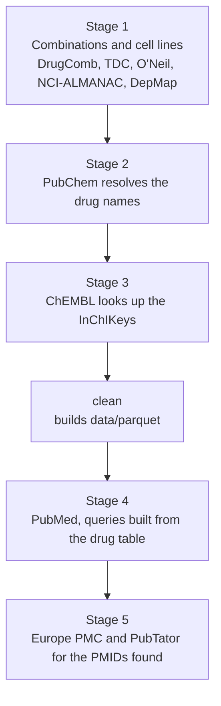

Each connector runs the same four steps: `discover` → `fetch` → `parse` → `validate`. Raw
files are **never modified**; the manifest keeps the SHA-256, size, URL, version and licence.

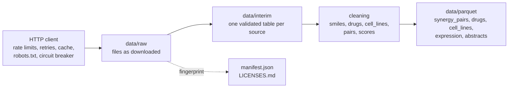

### 📦 What you get

Everything the pipeline produces is in **one folder**, `data/`, with one sub-folder per file
format. The extension of a file tells you where it is.
>>>>>>> d456fab (first commikt)

```
data/
  parquet/   les tables pour modéliser
  csv/       couverture, conflits, files de relecture, phrases à annoter
  json/      fichiers pour le frontend
  reports/   rapport qualité (Markdown et HTML), guide d'annotation

  raw/       fichiers tels que téléchargés, par source     interim/   une table validée par source
  manual/    fichiers que vous déposez vous-même           cache/ state/   suivi interne
```

<details>
<<<<<<< HEAD
<summary><b>📋 Détail des fichiers produits</b></summary>

| Fichier | Contenu |
=======
<summary><b>📋 Files produced</b></summary>

| File | Content |
>>>>>>> d456fab (first commikt)
|---|---|
| `data/parquet/synergy_pairs.parquet` | Une ligne par paire de médicaments, lignée, source et étude. Bliss, Loewe, HSA et ZIP dans des colonnes séparées |
| `data/parquet/drugs.parquet` | Une ligne par médicament : SMILES standardisé, InChIKey, PubChem CID, ChEMBL ID, synonymes, indicateur de validité |
| `data/parquet/cell_lines.parquet` | Noms, tissu, identifiant DepMap |
| `data/parquet/expression.parquet` | Matrice d'expression des lignées utilisées |
| `data/parquet/abstracts.parquet`, `candidate_sentences.parquet` | Résumés PubMed, et phrases citant au moins deux médicaments |
| `data/csv/coverage.csv`, `conflicts.csv`, `source_agreement.csv` | Médicaments et lignées distincts par source ; enregistrements en désaccord ; accord entre sources |
| `data/csv/drug_review_queue.csv`, `cell_line_review_queue.csv` | Noms qu'une personne doit vérifier |
| `data/csv/sample_sentences.csv` | Phrases stratifiées à annoter à la main (aussi `data/json/sample_sentences.jsonl`) |
| `data/json/*.json` | `drugs.json`, `cell_lines.json`, `mock_predictions_seed.json`, `citations.json` pour le frontend |
| `data/reports/data_quality.md` / `.html` | Rapport qualité ; `annotation_guide.md` explique les étiquettes |
| `manifest.json`, `LICENSES.md` | SHA-256, taille, URL, version, date de récupération et licence de chaque fichier |

</details>

<<<<<<< HEAD
📖 Chaque colonne est expliquée dans [docs/DATA_DICTIONARY.md](docs/DATA_DICTIONARY.md).

`data/raw` et `data/interim` sont les dossiers de travail du pipeline, avec un sous-dossier par source.
`manifest.json` et `LICENSES.md` sont à côté de `data/` : ils ne contiennent pas de données, ils
décrivent le dossier, et contrairement à `data/` ils peuvent être commités.
`--data-dir` déplace tout le dossier ; `parquet_dir`, `csv_dir`, `json_dir` et `reports_dir`
dans `config.yaml` permettent de déplacer un seul format.

---

<a id="installation"></a>

## ⚙️ Installation

Python **3.11 ou plus récent** requis.

```bash
python -m venv .venv
source .venv/bin/activate            # Windows PowerShell : .venv\Scripts\Activate.ps1
=======
📖 Every column is explained in [docs/DATA_DICTIONARY.md](docs/DATA_DICTIONARY.md).

`data/raw` and `data/interim` are the pipeline's working folders, with one sub-folder per
source. `manifest.json` and `LICENSES.md` sit next to `data/` rather than inside it: they hold
no data, they describe the folder, and unlike `data/` they can be committed. `--data-dir`
moves the whole folder; `parquet_dir`, `csv_dir`, `json_dir` and `reports_dir` in
`config.yaml` can point one format elsewhere.

### ⚙️ Setup

Requires Python **3.11 or newer**.

```bash
python -m venv .venv-dev
source .venv-dev/bin/activate        # Windows PowerShell: .venv-dev\Scripts\Activate.ps1
>>>>>>> d456fab (first commikt)
pip install -e ".[dev]"
cp .env.example .env                 # puis modifier .env
```

<<<<<<< HEAD
Renseignez deux valeurs dans `.env` (ignoré par git, jamais écrit dans les logs) :

| Variable | Obligatoire | Rôle |
|---|---|---|
| `CONTACT_EMAIL` | ✅ **oui** | Envoyé dans le User-Agent pour que les fournisseurs puissent vous joindre. Sans elle, les requêtes réelles sont refusées |
| `NCBI_API_KEY` | ➖ optionnelle | Gratuite depuis votre compte NCBI. Passe la limite E-utilities d'environ 3 à environ 10 requêtes par seconde |

Puis vérifiez la machine :

```bash
tujya preflight
```

---

<a id="utilisation"></a>

## ▶️ Utilisation
=======
Put two values in `.env` (ignored by git, never logged):

| Variable | Required | Role |
|---|---|---|
| `CONTACT_EMAIL` | ✅ **yes** | Sent in the User-Agent so a provider can reach you. Without it, live requests are refused |
| `NCBI_API_KEY` | ➖ optional | Free from your NCBI account. Raises the E-utilities limit from about 3 to about 10 requests per second |

Then check the machine: `synergyrx preflight`.

### ▶️ Running it
>>>>>>> d456fab (first commikt)

```bash
tujya fetch --sample 100 --dry-run   # affiche le plan, ne fait aucune requête ni écriture
tujya fetch --sample 100             # petit échantillon de chaque source activée
tujya fetch                          # exécution complète (environ 740 Mo pour l'étape 1)
tujya clean                          # construit les tables nettoyées (data/parquet)
tujya fetch --source pubmed --source europepmc
tujya literature                     # résumés, phrases candidates, échantillon à annoter
tujya report                         # rapport qualité, couverture, conflits, LICENSES.md
tujya export                         # JSON pour le frontend
tujya summary                        # rapport final de tout ce qui a été collecté
```

<<<<<<< HEAD
⚡ Ou tout en une fois, de façon incrémentale : `tujya update`.

Les étapes de `fetch` (voir le [schéma du pipeline](#schema-pipeline)) :

1. Combinaisons de médicaments et lignées : DrugComb, TDC, O'Neil, NCI-ALMANAC, DepMap.
2. PubChem résout les noms de médicaments trouvés à l'étape 1.
3. ChEMBL cherche les InChIKey renvoyés par PubChem.
4. PubMed, avec des requêtes bâties sur la table nettoyée des médicaments (**lancez donc `clean` avant**).
5. Europe PMC (accès libre) et PubTator, pour les PMID renvoyés par PubMed.

<details>
<summary><b>🧰 Toutes les commandes</b></summary>
=======
⚡ Or everything in one go, incrementally: `synergyrx update`. Run `clean` before the PubMed
stage: its queries are built from the cleaned drug table. The Tujya steps (ingredients,
interactions, labels, abstracts, corpus) are `python -m synergyrx_data.tujya <step>`
([docs/RAG.md](docs/RAG.md)).

<details>
<summary><b>🧰 All commands</b></summary>
>>>>>>> d456fab (first commikt)

| Commande | Ce qu'elle fait |
|---|---|
| `sources` | Liste les sources, licences et états. `--check` teste chaque lien et réécrit `docs/SOURCES.md` |
| `fetch` | Télécharge, analyse et valide dans `data/raw` et `data/interim`. Options : `--source`, `--sample N`, `--dry-run`, `--refresh` |
| `validate` | Revérifie les empreintes des fichiers bruts contre le manifeste et les lignes interim contre leurs schémas |
| `clean` | Construit les tables nettoyées dans `data/parquet` |
| `literature` | Stock de résumés, segmentation en phrases, mentions de médicaments, échantillon d'annotation |
| `report` | Rapport qualité, couverture, conflits, registre des licences |
| `export` | JSON pour le frontend |
| `status` | État de chaque connecteur et contenu du disque |
| `summary` | Rapport final de tout ce qui a été collecté (`--json` pour les machines) |
| `preflight` | Espace disque, permissions, identité, outils |
| `update` | Tout ce qui précède, de façon incrémentale. Pour cron ou CI |

Les options globales se placent avant la commande : `--config`, `--set clé=valeur`, `--data-dir`,
`--log-level`, `--text-logs`. Tout réglage de `config.yaml` peut être remplacé :

```bash
tujya --set sources.tdc.enabled=false --set "http.hosts[zenodo.org].rate=0.05" fetch
```

Les logs sont des lignes JSON sur stderr ; les tables et rapports vont sur stdout.

</details>

<<<<<<< HEAD
### 💸 Les relances sont peu coûteuses

Rien n'est téléchargé ni dupliqué deux fois :
=======
### 💸 Second runs are cheap

Nothing is downloaded or duplicated twice:

- raw files are skipped when their hash matches the manifest;
- API answers are cached on disk and revalidated with ETag / Last-Modified;
- lookups (including "not found") are remembered;
- interrupted downloads resume with an HTTP Range request;
- PubMed is only asked for records entered since the previous run.

### 📚 Pipeline sources
>>>>>>> d456fab (first commikt)

- les fichiers bruts sont ignorés si leur empreinte correspond au manifeste ;
- les réponses d'API sont en cache et revalidées avec ETag / Last-Modified ;
- les recherches (y compris « introuvable ») sont mémorisées ;
- les téléchargements interrompus reprennent avec une requête HTTP Range ;
- PubMed n'est interrogé que pour les notices ajoutées depuis la dernière exécution.

---

<a id="sources"></a>

## 📚 Sources

| Source | Accès | Activée par défaut | Licence |
|---|---|---|---|
<<<<<<< HEAD
| **DrugComb v1.4** | Fichier Zenodo, version fixée | ✅ | CC BY 4.0 |
| **TDC DrugSyn** | Fichier Harvard Dataverse (chargé avec PyTDC si installé) | ✅ | CC BY 4.0 |
| **O'Neil / DeepSynergy** | CSV | ✅ | aucune indiquée : usage de recherche, ne pas redistribuer |
| **NCI-ALMANAC** | ✋ **téléchargement manuel** | ✅ | Travail du gouvernement américain |
| **DepMap / CCLE 24Q4** | API et fichiers Figshare+ | ✅ | CC BY 4.0 |
| **PubChem** | API PUG-REST | ✅ | domaine public |
| **ChEMBL** | API web services | ✅ | CC BY-SA 3.0 |
| **PubMed** | API E-utilities | ✅ | conditions NLM |
| **Europe PMC** | API REST | ✅ | conditions Europe PMC |
| GDSC (Cell Model Passports) | fichier | ⬜ | non vérifiée |
| DDInter | CSV, accès conditionné | ⬜ | CC BY-NC-SA 4.0 |
| DrugBank | ✋ **fichier que vous fournissez** | ⬜ | licence DrugBank |
| PubMed baseline | XML très volumineux, ✋ **téléchargement manuel** | ⬜ | conditions NLM |
| PubTator 3 | API | ⬜ | domaine public |

🔗 États des liens, points d'accès, limites de débit et résultats par source : [docs/SOURCES.md](docs/SOURCES.md).
Licences et citations : `LICENSES.md`.

### ✋ Étapes manuelles

> [!IMPORTANT]
> Certaines sources interdisent le téléchargement automatisé. Le pipeline ne contourne **jamais** ces règles.

- **NCI-ALMANAC.** Le robots.txt de `wiki.nci.nih.gov` interdit les téléchargements automatiques. Ouvrez la
  [page NCI-ALMANAC](https://wiki.nci.nih.gov/spaces/NCIDTPdata/pages/338237347/NCI-ALMANAC)
  dans un navigateur, enregistrez `ComboDrugGrowth_Nov2017.zip` (et, en option,
  `ComboCompoundNames_small.txt`) dans `data/manual/nci_almanac/`, puis relancez `fetch`.
- **PubMed baseline** (optionnel). `ftp.ncbi.nlm.nih.gov` interdit les clients automatisés dans son
  robots.txt. Téléchargez vous-même les fichiers listés dans `sources.pubmed_baseline.options.files`
  et placez-les dans `data/manual/pubmed_baseline/`.
- **DrugBank.** Jamais téléchargé. Si vous avez une licence, enregistrez l'export du vocabulaire sous
  `data/manual/drugbank/drugbank vocabulary.csv` et mettez `sources.drugbank.enabled: true`.
- **DDInter.** Lisez ses [conditions](https://ddinter2.scbdd.com/terms/) (non commercial,
  partage à l'identique), puis mettez `sources.ddinter.enabled: true` et `terms_acknowledged: true`.
- **TDC via PyTDC.** PyTDC s'installe seulement sur Python 3.11 / 3.12 :
  `pip install -e ".[tdc]"`. Sans lui, le même fichier est lu par un chargeur intégré.
- **Médicaments et lignées non résolus.** Traitez `data/csv/drug_review_queue.csv` et
  `data/csv/cell_line_review_queue.csv`, notez vos décisions dans
  `config/manual_drug_overrides.csv` et `config/cell_line_aliases.csv`, puis relancez `clean`.

---

<a id="comportement-reseau"></a>

## 🌐 Comportement réseau
=======
| **DrugComb v1.4** | Zenodo bulk file, pinned | ✅ | CC BY 4.0 |
| **TDC DrugSyn** | Harvard Dataverse file (loaded with PyTDC when installed) | ✅ | CC BY 4.0 |
| **O'Neil / DeepSynergy** | bulk CSV | ✅ | none stated: research use, do not redistribute |
| **NCI-ALMANAC** | ✋ **manual download** | ✅ | US Government work |
| **DepMap / CCLE 24Q4** | Figshare+ API and files | ✅ | CC BY 4.0 |
| **PubChem** | PUG-REST API | ✅ | public domain |
| **ChEMBL** | web services API | ✅ | CC BY-SA 3.0 |
| **PubMed** | E-utilities API | ✅ | NLM terms |
| **Europe PMC** | REST API | ✅ | Europe PMC terms |
| GDSC (Cell Model Passports) | bulk file | ⬜ | not verified |
| DDInter | bulk CSV, gated | ⬜ (the Tujya steps enable it) | CC BY-NC-SA 4.0 |
| DrugBank | ✋ **file you supply** | ⬜ | DrugBank licence |
| PubMed baseline | very large bulk XML, ✋ **manual download** | ⬜ | NLM terms |
| PubTator 3 | API | ⬜ | public domain |

🔗 Link statuses, endpoints, rate limits and what was found for each source:
[docs/SOURCES.md](docs/SOURCES.md). Licences and citations: `LICENSES.md`.

#### ✋ Manual steps

> [!IMPORTANT]
> Some sources forbid automated downloads. The pipeline **never** works around these rules.

- **NCI-ALMANAC.** The robots.txt of `wiki.nci.nih.gov` disallows automated downloads. Open the
  [NCI-ALMANAC page](https://wiki.nci.nih.gov/spaces/NCIDTPdata/pages/338237347/NCI-ALMANAC)
  in a browser and save `ComboDrugGrowth_Nov2017.zip` (and, optionally,
  `ComboCompoundNames_small.txt`) into `data/manual/nci_almanac/`, then run `fetch` again.
- **PubMed baseline** (optional). `ftp.ncbi.nlm.nih.gov` disallows automated clients in its
  robots.txt. Download the files listed in `sources.pubmed_baseline.options.files` yourself
  and save them into `data/manual/pubmed_baseline/`.
- **DrugBank.** Never downloaded. If you hold a licence, save the vocabulary export as
  `data/manual/drugbank/drugbank vocabulary.csv` and set `sources.drugbank.enabled: true`.
- **DDInter.** Read its [terms](https://ddinter2.scbdd.com/terms/) (non-commercial,
  share-alike), then set `sources.ddinter.enabled: true` and `terms_acknowledged: true`.
- **TDC through PyTDC.** PyTDC only installs on Python 3.11 / 3.12:
  `pip install -e ".[tdc]"`. Without it, the same file is read by a built-in loader.
- **Unresolved drugs and cell lines.** Work through `data/csv/drug_review_queue.csv` and
  `data/csv/cell_line_review_queue.csv`, record decisions in
  `config/manual_drug_overrides.csv` and `config/cell_line_aliases.csv`, and run `clean`.

### 🌐 How it behaves on the network

| Rule | Detail |
|---|---|
| 🪪 Identification | `synergyrx-data/<version> (research data pipeline; mailto:<you>)` |
| 🚦 Rate | Per-host token-bucket limits and connection caps, run at 90 % of each limit; a robots.txt `Crawl-delay` wins when it is slower |
| 🔁 Retries | Exponential backoff with jitter; honours `Retry-After`, 429 and 503 |
| 🔌 Circuit breaker | Pauses a source that keeps failing |
| 🧱 Guardrails | Timeouts, maximum response sizes and content-type checks on every response |
| 🤖 robots.txt | Checked before any HTML page or bulk file is requested |
| 🛑 Blocking | A 401 / 403, CAPTCHA, login page or bot check stops the source: it is reported as "needs attention", never retried or worked around |
| 🚫 Forbidden | No cookies, no credentials, no proxies, no browser impersonation |

A source that fails does not stop the run: the others continue and `status` shows which one
needs attention and why. `fetch` and `update` then exit with a non-zero code.

### ⏰ Scheduling and Docker
>>>>>>> d456fab (first commikt)

| Règle | Détail |
|---|---|
| 🪪 Identification | `tujya-data/<version> (research data pipeline; mailto:<vous>)` |
| 🚦 Débit | Limites par hôte (token bucket) et plafonds de connexions, à 90 % de chaque limite ; un `Crawl-delay` du robots.txt l'emporte s'il est plus lent |
| 🔁 Reprises | Backoff exponentiel avec gigue ; respecte `Retry-After`, 429 et 503 |
| 🔌 Coupe-circuit | Met en pause une source qui échoue sans cesse |
| 🧱 Garde-fous | Délais d'attente, tailles maximales et contrôle du type de contenu sur chaque réponse |
| 🤖 robots.txt | Vérifié avant toute page HTML ou fichier volumineux |
| 🛑 Blocage | Un 401 / 403, CAPTCHA, page de connexion ou contrôle anti-robot arrête la source : elle passe en « needs attention », jamais relancée ni contournée |
| 🚫 Interdits | Pas de cookies, pas d'identifiants, pas de proxys, pas d'imitation de navigateur |

Une source en échec n'arrête pas l'exécution : les autres continuent et `status` indique laquelle
demande attention et pourquoi. `fetch` et `update` se terminent alors avec un code non nul.

---

<a id="planification-et-docker"></a>

## ⏰ Planification et Docker

`tujya update` peut être relancé sans risque. Exemples :
[docs/examples/crontab.txt](docs/examples/crontab.txt) et
[docs/examples/github-actions-update.yml](docs/examples/github-actions-update.yml).

```bash
docker build -t tujya-data .
docker run --rm --env-file .env -v "$PWD/data:/app/data" tujya-data fetch --sample 100
```

<<<<<<< HEAD
Ajoutez `--build-arg INSTALL_TDC=1` pour inclure PyTDC. Les secrets sont passés à l'exécution et
ne font pas partie de l'image.

---

<a id="application-web"></a>

## 🖥️ Application web

Un backend **FastAPI** (`backend/`) et un frontend **React** (`frontend/`) au-dessus des tables nettoyées
(voir le [schéma de l'application](#schema-application)). Ils sont séparés du pipeline : le backend a son propre
environnement virtuel et lit uniquement les tables de `data/parquet`.

```bash
# Terminal 1 : API sur http://127.0.0.1:8000 (documentation interactive sur /api/docs)
cd backend
python -m venv .venv
.venv\Scripts\Activate.ps1           # Linux / macOS : source .venv/bin/activate
pip install -r requirements-dev.txt
uvicorn app.main:app --reload

# Terminal 2 : site sur http://localhost:5173
cd frontend
npm install
npm run dev
```

Ouvrez <http://localhost:5173>. Le serveur de développement redirige `/api` vers le backend : le navigateur
ne parle qu'à une seule origine. Les visiteurs voient d'abord une page d'introduction publique ; elle affiche la
taille des tables (`/api/public/summary`), seule donnée lisible sans compte.

🎨 Le site porte la marque **Tujya**. Les logos de `frontend/src/assets/` et le favicon sont découpés dans
`photo.png`, le nom est dans `frontend/src/brand.ts`, et les couleurs, toutes tirées du logo, sont les variables
en haut de `frontend/src/styles.css`.

### 🔑 Comptes créés au premier démarrage (dans `backend/app.db`)

| Email | Mot de passe | Arrive sur |
|---|---|---|
| `admin@gmail.com` | `admin` | `/admin` : tableau de bord et gestion des utilisateurs |
| `user@gmail.com` | `user` | `/home` : accueil, médicaments, lignées, profil |

> [!CAUTION]
> **Changez le mot de passe administrateur avant que quiconque puisse atteindre le serveur** (Admin, puis
> Mon compte). L'API affiche un avertissement à chaque démarrage tant qu'il n'est pas changé.
> Pour démarrer avec d'autres identifiants, copiez `backend/.env.example` vers `backend/.env` avant le premier démarrage.

**Règles de sécurité**

- 👥 Tout le monde peut s'inscrire ; un nouveau compte est toujours un utilisateur simple. Seul un administrateur
  peut créer des administrateurs, changer les rôles, réinitialiser les mots de passe, désactiver ou supprimer des comptes.
- 🔒 Les mots de passe sont stockés en hachage Argon2 : on peut les remplacer, jamais les relire. Minimum 8 caractères.
- 🍪 La session est un cookie `HttpOnly` lié à une ligne en base : réinitialiser un mot de passe ou désactiver un
  compte déconnecte l'utilisateur immédiatement.
- ✅ Le rôle est vérifié par l'API à chaque requête ; masquer une page dans le frontend ne sert qu'au confort.

Vérifications : `python -m pytest` dans `backend/` (tests d'API sur une base temporaire), et
`npm run build` dans `frontend/` (contrôle des types et build de production).

---

<a id="developpement"></a>

## 🛠️ Développement

```bash
make check        # lint, typage, tests unitaires (HTTP simulé, sans réseau)
make live         # tests de fumée optionnels sur les vrais services, petits échantillons
pre-commit install
```

Sans `make` (Windows simple) : `python -m ruff check src tests`, `python -m mypy`,
`python -m pytest tests/unit`, `python -m pytest tests/live -m live`.

➕ **Ajouter une source** = écrire une sous-classe `Connector` (`discover`, `fetch`, `parse`,
`validate`) et l'enregistrer dans `src/tujya_data/connectors/__init__.py`. Lisez
d'abord [docs/CODE_REVIEW.md](docs/CODE_REVIEW.md).

---

<a id="structure-du-depot"></a>

## 🗂️ Structure du dépôt

```
config.yaml              réglages (sans secrets)       .env        secrets (ignoré par git)
src/tujya_data/
  cli.py  pipeline.py  build.py  config.py  manifest.py
  http/         client, ratelimit, retry, cache, robots, circuit, guardrails
  connectors/   un module par source
=======
Add `--build-arg INSTALL_TDC=1` to include PyTDC. Secrets are passed at run time and are not
part of the image.

➕ **Adding a source** means writing one `Connector` subclass (`discover`, `fetch`, `parse`,
`validate`) and registering it in `src/synergyrx_data/connectors/__init__.py`. Read
[docs/CODE_REVIEW.md](docs/CODE_REVIEW.md) first.

---

<a id="repository-layout"></a>

## 🗂️ Repository layout

```
config.yaml              settings (no secrets)        .env        secrets (git-ignored)
src/synergyrx_data/      the data pipeline
  cli.py  pipeline.py  build.py  config.py  manifest.py
  http/         client, ratelimit, retry, cache, robots, circuit, guardrails
  connectors/   one module per source (including openfda, ddinter, pubmed)
>>>>>>> d456fab (first commikt)
  cleaning/     smiles, drugs, cell_lines, pairs, scores
  literature/   queries, abstracts, sentences, mentions, annotation_export
  quality/      reports, drift, licenses, linkcheck
  export/       frontend
<<<<<<< HEAD
tests/unit/     HTTP simulé        tests/live/   tests de fumée optionnels
backend/app/    FastAPI : comptes, sessions, routes admin, lecture de data/parquet
frontend/src/   React : introduction, connexion / inscription, pages utilisateur, pages admin
data/           tout ce qui est produit, par format : parquet, csv, json, reports ; et les
                dossiers de travail raw, interim, manual, cache, state   (ignoré par git)
docs/           PLAN, STATUS, DECISIONS, SOURCES, DATA_DICTIONARY, CODE_REVIEW, exemples
```

---

## 👥 Équipe

🏫 TEK-UP University · Projet de Deep Learning

| 👤 Membre | 🎯 Rôle principal |
|---|---|
| Mohamed Raed Bouhali | à définir par l'équipe |
| Ilef Ben Hassen | à définir par l'équipe |
| Melek Bouabid | à définir par l'équipe |

**Répartition proposée** (à valider ensemble) :

| Rôle | Responsabilités |
|---|---|
| 🧹 **A · Données et Machine Learning** | Collecte et nettoyage, découpages de test, baselines, métriques, calibration |
| 🧠 **B · Deep Learning** | Modèles MLP et GNN, fusion multimodale, entraînement, interprétation |
| 📚 **C · Littérature, démo et rapport** | Extraction PubMed, application web, rédaction du rapport |
=======
  tujya/        Tujya steps: ingredients, interactions, RAG corpus
tests/unit/     mocked HTTP        tests/live/   optional smoke tests
backend/app/    FastAPI: accounts, scan, interactions, chat, toxicity, reports, admin
  rag/          LangGraph agent, tools, retrieval, ChromaDB store, safety rules
  routers/      one module per API area
  mcp_server.py the agent's tools over MCP
backend/scripts/  RAG benchmarks, Tox21 and synergy training, scan evaluation
frontend/src/   React: landing, sign in / sign up, Scanner and chat, reports, toxicity, admin
vision/         pill detection and identification (own venv: training, ONNX export, publish)
benchmark/      RAG question sets and results
config/         pill classes, splits, aliases, demo gallery, ingredient structures
docker/         MLflow image, Ollama CPU variant, PostgreSQL init script
models/         ONNX and Tox21 models served by the API   (git-ignored)
data/           everything produced, by format: parquet, csv, json, reports; and the working
                folders raw, interim, manual, cache, state   (DVC; only *.dvc files in git)
docs/           pipeline: PLAN, STATUS, DECISIONS, SOURCES, DATA_DICTIONARY, CODE_REVIEW
                Tujya: VISION, API, RAG, AGENT, MCP, BENCHMARK, INFRA, CD, DEMO, rapports/
```

🎨 The site is branded **Tujya**: the logos in `frontend/src/assets/` and the favicon are cut
from `photo.png`, the name is in `frontend/src/brand.ts`, and the colours, all taken from the
logo, are the tokens at the top of `frontend/src/styles.css`.

---

<a id="team"></a>

## 👥 Team

🏫 **TEK-UP University** · modules *Industrialisation, Vision & MLOps* and *AI Engineering*

| 👤 Member |
|---|
| Mohamed Raed Bouhali |
| Ilef Ben Hassen |
| Melek Bouabid |
>>>>>>> d456fab (first commikt)

---

<div align="center">

<<<<<<< HEAD
🚨 **Avertissement** : les résultats de ce projet sont des hypothèses de recherche in silico, à valider en laboratoire.
Ils ne constituent en aucun cas un conseil médical .
=======
🚨 **Disclaimer:** Tujya gives information only. It does not replace a pharmacist or a doctor,
never gives a dose and never says a combination is safe.
>>>>>>> d456fab (first commikt)

</div>
