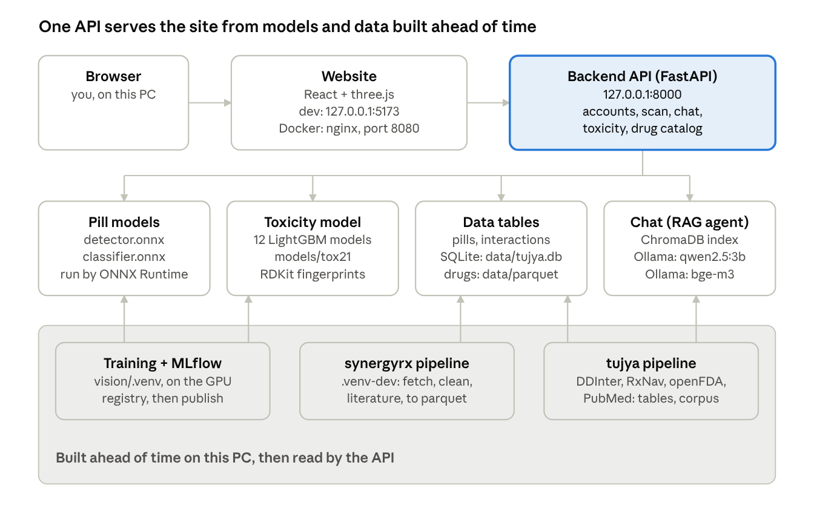
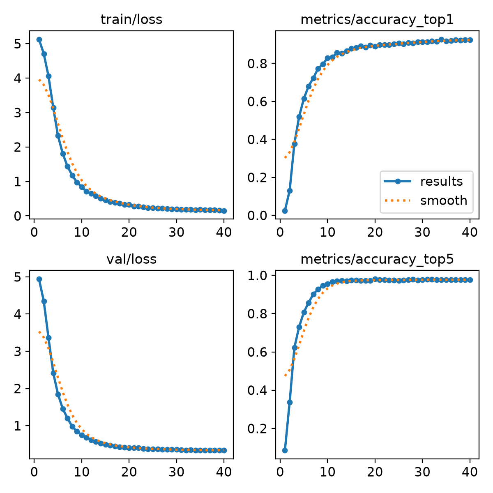
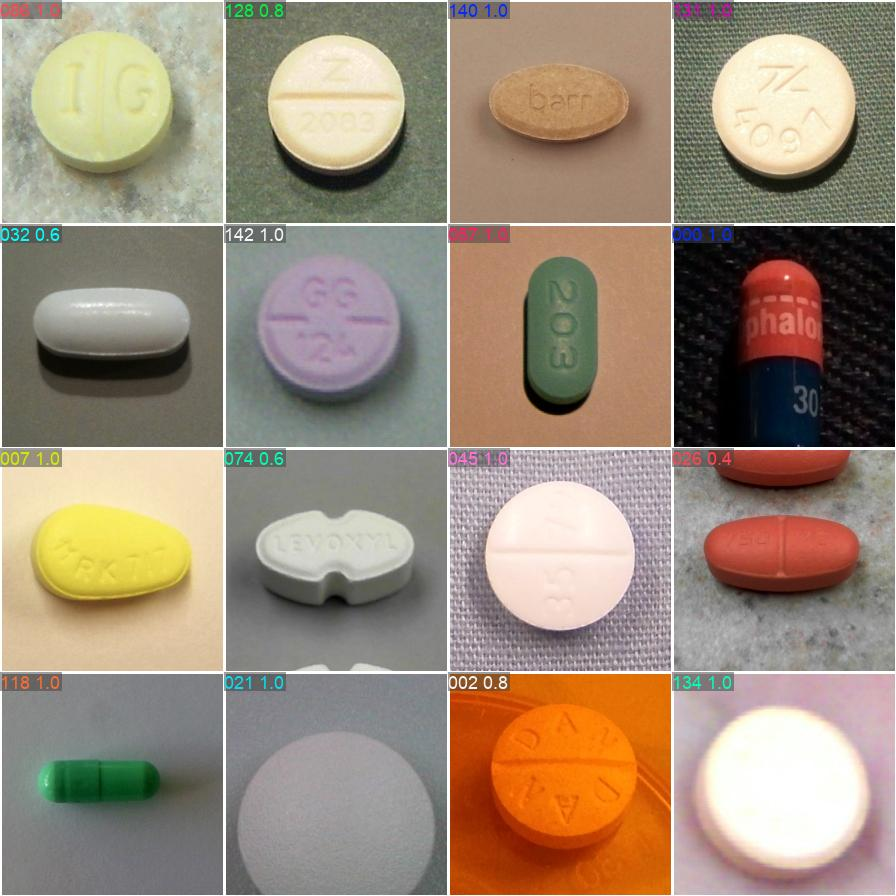
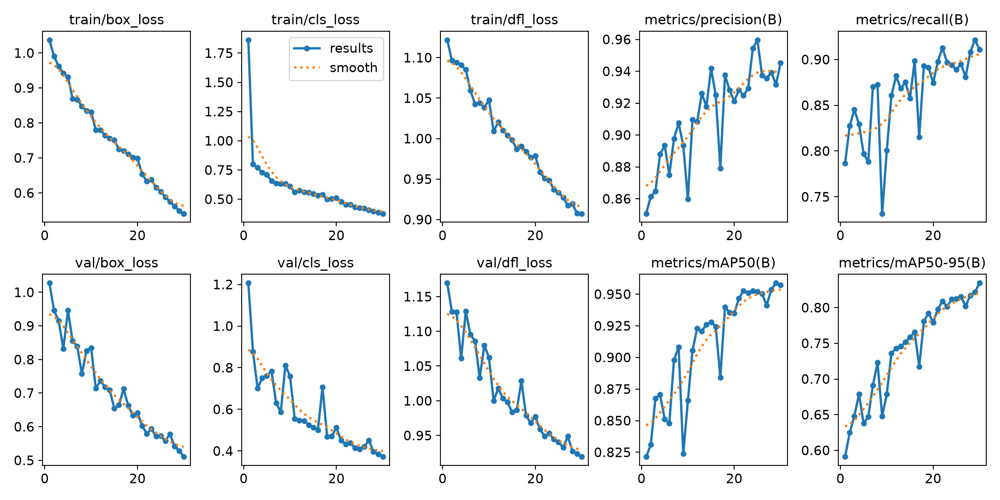
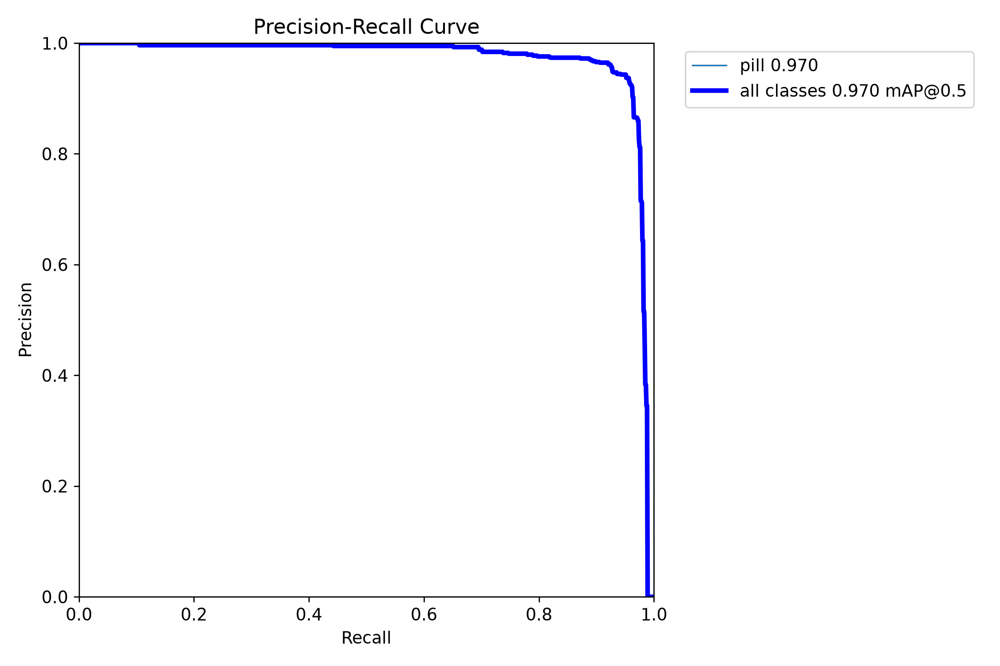
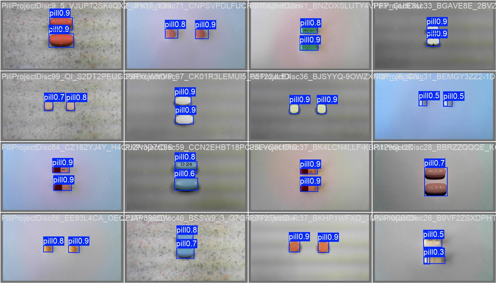
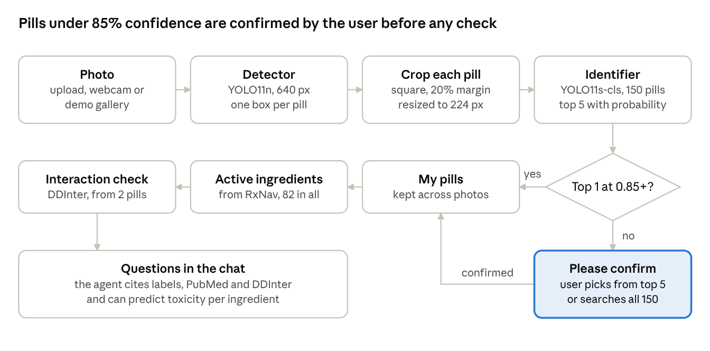
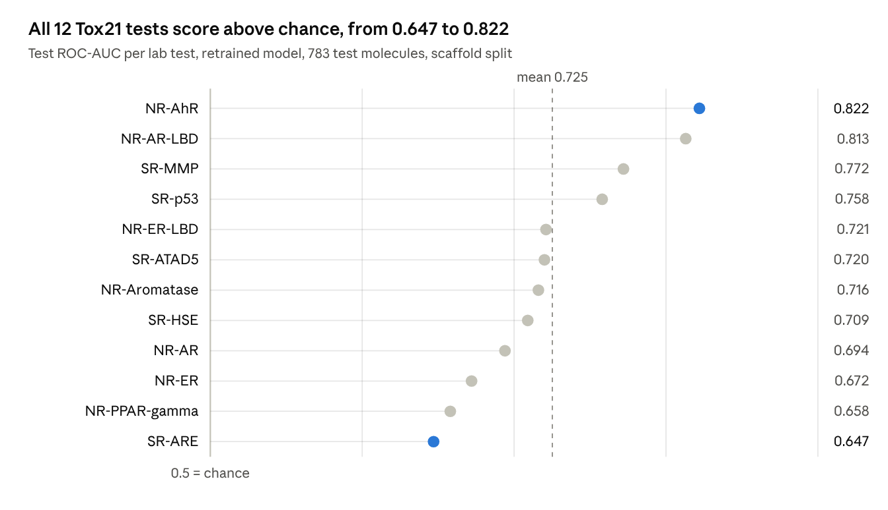
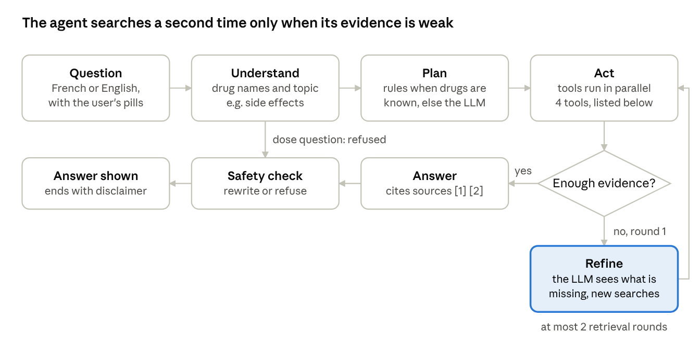

# Tujya: Restoration and Model Report

**Date:** 1 November 2026 · **Machine:** Lenovo laptop, Intel Core i7-13650HX, NVIDIA GeForce RTX 4050 Laptop GPU (6 GB), 32 GB RAM, Windows 11 · **Scope:** what was restored on this PC, every model the application uses, how each one was trained, and the results.

> **In short.** Every page of the Tujya website works again on this PC. The missing data was rebuilt from public sources, and the three trained models were retrained with their original settings. Their test scores land within about one point of the original ones. The same day, the application itself gained six updates (decisions D81 to D86, section 2.3). The largest is D86: chat answers now come from a hosted model on Groq, with the local model as fallback, so questions no longer stay on this PC while it is on.

## 1. Summary

The project was built on another PC (user `msi`). When it was copied to this PC, the trained models, the MLflow history and the drug tables (`data/parquet`) stayed behind. The DVC backup folder that held copies (`C:\Users\msi\dvc-storage\tujya`) had been deleted (decision D80), and no copy existed anywhere on this PC.

| Feature | Before this session | After this session |
|---|---|---|
| Scanner (detect and identify pills) | Broken: `models/` folder missing | Retrained on the RTX 4050; correct first guess 93.9 % |
| Toxicity page | Broken: `models/tox21` missing | Retrained; mean test ROC-AUC 0.725, same as before |
| Drugs and Cell lines pages | Broken: `data/parquet` missing | Rebuilt: 3,740 drugs, 112 cell lines, 970,649 measurements |
| Chat (RAG agent) | Working, local model, 8,933 passages | Updated (D84 to D86): answers from Groq `qwen/qwen3.8-27b` with local fallback; 9,695 passages |
| Interaction check | Working | Unchanged: 40,508 drug pairs (DDInter) |

## 2. What was done in this session

### 2.1 Timeline

| Time | Step | Result |
|---|---|---|
| 13:30 to 15:30 | Started the backend and the website | Three start-up problems fixed (2.2, rows 1 to 3) |
| 16:20 | Searched for copies of the missing data | None: no Docker volumes, no DVC cache entry, no model files |
| 16:30 | Started downloading the drug data | Contact email set in `.env`, as the data providers require |
| 17:15 | Downloaded the NCI-ALMANAC files | 86 MB zip holding a 615 MB table, plus 107 drug names |
| 17:17 | MLflow and PostgreSQL containers running | MLflow at `127.0.0.1:5000` after a 45-minute image build |
| 17:18 to 17:20 | Trained and published the toxicity model | 98 s on the CPU; mean test ROC-AUC 0.725 |
| 17:18 to 17:31 | Trained the pill identifier on the GPU | 40 epochs in 8.8 min; test top-1 93.9 % |
| 17:31 to 17:33 | First detector run | Froze after a data worker crashed (2.2, row 6) |
| 19:04 | First drug-table build finished | 3,737 drugs, 666,298 measurements, 1,241 abstracts |
| 19:04 to 19:40 | Second pass on the drug tables | NCI-ALMANAC added (311,466 rows); ChEMBL completed |
| 19:40 | Stopped the frozen detector run, marked it FAILED in MLflow | Memory freed |
| 19:42 to 20:19 | Retrained the detector with 2 data workers | 30 epochs in 33.7 min; test mAP50 0.970 |
| 20:20 | Published both pill models to `models/`, tested the Scanner | Fluconazole found at 99.9 %, tramadol at 99.0 % |

### 2.2 Problems met and how they were fixed

| # | Symptom | Cause | Fix |
|---|---|---|---|
| 1 | Backend: `WinError 10013` on port 8000 | A test server started during the check was still holding the port | Stopped that process |
| 2 | Backend: `No module named 'app'` | `uvicorn` was run from the project root with the global Python | Run it from `backend\` with `.\.venv\Scripts\python.exe -m uvicorn ...` |
| 3 | Site: "Cannot reach the server" | The Vite website server was not running | `npm run dev` in `frontend\` |
| 4 | Drugs page: "table not available" | `data/parquet` missing, DVC backup deleted | Rebuilt with the `synergyrx` pipeline (section 9) |
| 5 | Scanner and Toxicity fail | `models/` missing; no MLflow registry on this PC | MLflow started in Docker; all three models retrained |
| 6 | Detector training froze at 17:33 | A data worker could not load `cublas64_13.dll` (`WinError 1455`): Windows memory commit limit, while the drug build used a lot of memory | Run stopped and marked FAILED; retrained with `--workers 2` |
| 7 | O'Neil source not downloaded | Its server `bioinf.jku.at` was down on both tries | Skipped; the same study is included in DrugComb |
| 8 | ChEMBL lookups incomplete | Network timeouts on the first pass | Completed on the second pass (3,503 molecules) |
| 9 | NCI-ALMANAC not downloaded automatically | The site's `robots.txt` blocks automated clients | Downloaded once, at the user's explicit request |

### 2.3 Other updates to the application on the same day (D81 to D86)

These changes were made in parallel with the restore and are recorded in `docs/DECISIONS.md`.

| Decision | What changed | What it means for users |
|---|---|---|
| D81 | Light/dark toggle; interface in English, French and Russian (`src/locales/`) | The site follows the system theme and browser language, and remembers the choice. Safety texts stay in French in every language |
| D82 | Activity log for administrators (`activity` table, `GET /api/admin/activity`) | Sign-ins, scans, checks, questions and admin actions are recorded with time and IP, as counts only: never a medicine name, photo or question text. Kept 180 days |
| D83 | Footer; saved pills; reports with share links; usage report; About, Privacy and Help pages | "My pills" survives a reload (10 at most). A report re-checks interactions, keeps ticked chat answers (sealed with HMAC-SHA256 so they cannot be edited), prints as one A4 page, and can be shared read-only for 1 to 30 days |
| D84 | Greetings and off-topic questions get a direct answer | Medical questions still get the cited answer. A question whose best search hit is below 0.52 similarity is answered briefly from general knowledge and labelled as such |
| D85 | Standard recursive chunking (1,000 characters, 200 overlap); search filter fixed | 9,695 passages instead of 8,933. Questions about drugs outside the 82 ingredients now find their abstracts (literature questions: 100 % in the top 5) |
| D86 | Answers from Groq (`qwen/qwen3.8-27b`), local `qwen2.5:3b` as fallback | Better answers in French and Russian (about 1.1 s). The question, confirmed pills and retrieved passages are sent to Groq; embeddings and the index stay local |

## 3. System architecture



| Component | Technology and version | Address | Role |
|---|---|---|---|
| Website | React 19, Vite 8, three.js 0.186 | `127.0.0.1:5173` (dev), `:8080` (Docker, nginx) | Pages, Scanner, chat panel |
| Backend API | FastAPI, Python 3.14 (dev venv) | `127.0.0.1:8000`, Swagger at `/docs` | Accounts, scan, interactions, chat, toxicity, catalog |
| Pill models | ONNX Runtime, CPU | inside the API | Detection and identification |
| Medicine tables | SQLite `data/tujya.db` (dev), PostgreSQL 16 (Docker) | inside the API | Pills, ingredients, interactions |
| Vector index | ChromaDB 1.5.9, folder `data/rag/chroma` | inside the API | Search over 9,695 passages |
| Answer model (D86) | Groq API, `qwen/qwen3.8-27b` | online (Groq) | Plans tool calls and writes chat answers |
| Local LLM and embeddings | Ollama 0.40.13 | `127.0.0.1:11434` | bge-m3 embeddings; qwen2.5:3b as answer fallback |
| Experiment tracking | MLflow 3.17.2 + PostgreSQL 16 (pgvector), Docker | `127.0.0.1:5000`, `:5432` | Training runs and Model Registry |

Every service on this PC listens on `127.0.0.1` only, so nothing is reachable from another machine. Since D86, though, each chat question, the confirmed pills and the retrieved passages are sent to Groq. Setting `SYNERGYRX_LLM_PROVIDER=ollama` in `backend/.env` restores the fully local setup.

## 4. Models used

| Model | Job | Architecture and size | Trained by the project? | Runs on |
|---|---|---|---|---|
| Pill detector | Find each pill in a photo | YOLO11n (Ultralytics 8.4.191), 2.59 M parameters, 6.5 GFLOPs, input 640 x 640; ONNX file 10.7 MB | Yes, fine-tuned from COCO weights | ONNX Runtime, CPU |
| Pill identifier | Name the pill among 150 products | YOLO11s-cls, 5.64 M parameters, input 224 x 224, 150 outputs; ONNX file 22.6 MB | Yes, fine-tuned from ImageNet weights | ONNX Runtime, CPU |
| Toxicity model | Probability of activity in 12 Tox21 lab tests | 12 LightGBM 4.7.0 boosted-tree models on 2,048-bit Morgan fingerprints (RDKit 2026.09.1); 9.4 MB | Yes, from scratch | Backend, CPU |
| Answer model (default since D86) | Plan tool calls; write chat answers | `qwen/qwen3.8-27b`, hosted by Groq, thinking mode off; free key limited to 8,000 tokens a minute (2 or 3 questions) | No, used as published | Groq, online |
| Fallback language model | Answer when Groq fails or hits its limit | qwen2.5:3b (Qwen 2.5, 3 billion parameters, instruction-tuned); 1.9 GB | No, used as published | Ollama, GPU |
| Embedding model | Turn text into vectors for search | bge-m3 (BAAI), 1,024 dimensions, multilingual; 1.2 GB | No, used as published | Ollama, GPU |

A drug-synergy model on DrugComb was also studied but **not deployed**: the rule fixed before training (RMSE at least 10 % below the mean baseline and correlation r of at least 0.3, split by drug) was not met (RMSE 7.3 % below, r 0.377). Details: `docs/SYNERGY.md`.

## 5. Pill recognition: data and training

### 5.1 Training data

- **Source:** the public NLM C3PI dataset (Computational Photography Project for Pill Identification), licence ODbL, research use. 150 pill products (NDC9 + part), up to 30 consumer photos each plus one reference image per product: 4,206 files, 4.8 GB, already on this PC.
- **Split by photo:** 70 / 15 / 15, stratified by product: 3,006 train, 600 validation, 600 test photos. A photo and all its crops stay in one split.
- **Boxes made by code (decision D38):** C3PI has no pill boxes, so `vision/tujya_vision/autolabel.py` finds them with classical image processing: a background surface fitted in Lab colour space, colour distance with shadows down-weighted, coin rejection, and GrabCut for crescent-shaped shadows. A photo with a doubtful flag is left out of both datasets.

| Auto-labelling result | Photos |
|---|---:|
| Consumer photos | 4,056 |
| Clean, used | 3,306 (81.5 %) |
| Left out: irregular region (shadow or half a pill) | 462 |
| Left out: no region (pill too close to the background colour) | 346 |
| Left out: other doubtful flags | 73 |
| Hand check of 48 random photos: every box correct | about 90 % |

- **Detector dataset:** 2,345 train / 478 validation / 483 test photos, long side 640 px.
- **Identifier dataset:** 2,962 / 562 / 589 square crops at 224 px (at most two per photo, front and back), plus crops of the reference images in train. The test set covers 148 classes: two products have no clean test photo.

### 5.2 Training configuration

| Setting | Detector | Identifier |
|---|---|---|
| Command (in `vision\`) | `python -m tujya_vision.train detect --epochs 30 --imgsz 640 --batch 8 --workers 2` | `python -m tujya_vision.train classify --epochs 40 --weights yolo11s-cls.pt` |
| Starting weights | `yolo11n.pt`, pretrained on COCO | `yolo11s-cls.pt`, pretrained on ImageNet |
| Image size | 640 px | 224 px |
| Epochs | 30 | 40 |
| Batch size | 8 | 32 |
| Optimizer (chosen automatically by Ultralytics) | AdamW, learning rate 0.002, momentum 0.9 | AdamW, learning rate 0.000065, momentum 0.9 |
| Weight decay | 0.0005 | 0.0005 |
| Warm-up | 3 epochs | 3 epochs |
| Mixed precision (AMP) | On | On |
| Augmentation | Mosaic of 4 photos (off for the last 10 epochs), colour jitter (HSV), shift 0.1, scale 0.5, horizontal flip 0.5 | RandAugment, random erasing 0.4, colour jitter, horizontal flip 0.5 |
| Early stopping | Patience 20 epochs, not triggered | Patience 20 epochs, not triggered |
| Seed | 0, deterministic | 0, deterministic |
| Training time | 33.7 min | 8.8 min |
| Software | Python 3.14.2, PyTorch 2.14.1 + CUDA 13.0, Ultralytics 8.4.191 | same |

### 5.3 Results

Scores on the test split (photos never used in training):

| Metric | Original (RTX 2050, 28 Oct) | Retrained (RTX 4050, 1 Nov) |
|---|---:|---:|
| Identifier: correct first guess (top-1) | 93.5 % | **93.9 %** |
| Identifier: correct pill in top 5 | 98.1 % | **97.6 %** |
| Detector: mAP50 | 0.972 | **0.970** |
| Detector: mAP50-95 | 0.861 | **0.850** |
| Detector: precision | 0.957 | **0.942** |
| Detector: recall | 0.936 | **0.951** |

At the last epoch, on the validation split: identifier top-1 92.5 % and top-5 97.7 %; detector mAP50 0.957 and mAP50-95 0.834. Speed on the GPU: 0.6 ms per crop for the identifier, 5.6 ms per photo for the detector.

**How to read these numbers.** Train and test hold different photos of the same physical pills, and the detector is scored against machine-made boxes (about 90 % correct). Accuracy on new pill instances would be lower.











### 5.4 Export, checks and registry

Each training run ends the same way: it evaluates on the test split, exports the best weights to ONNX, checks ONNX Runtime against PyTorch, logs everything to the MLflow experiment `tujya-vision`, and registers the ONNX file in the Model Registry.

| Model | MLflow run ID | Registered as | ONNX input / output | ONNX vs PyTorch check |
|---|---|---|---|---|
| Identifier | `9e118a986ca8420383754100514d54a1` | `tujya-pill-classifier` v1 | 1 x 3 x 224 x 224 / 1 x 150 | Same top-1 on 100 % of checked crops; largest probability gap 0.0000015 |
| Detector | `351bf9233a214f78ac0a3deab83959e0` | `tujya-pill-detector` v1 | 1 x 3 x 640 x 640 / 1 x 5 x 8400 | Same box count on 100 % of checked photos; mean box overlap (IoU) 0.992 |
| Detector, failed run | `275541cd206140e4b10831d4ebc1a64f` | not registered | | Marked FAILED, with a note on the cause |

`python -m tujya_vision.publish` then copies both registered files to `models/` and records their SHA-256 hashes in `models/models.json` (detector `7fb8b52d76df...`, classifier `e85d34676f57...`).

## 6. The prediction system, from photo to answer



The flow runs in `POST /api/scan` (`backend/app/scanner.py`) and the Scanner page:

1. **Photo in:** upload, webcam or demo gallery. JPEG, PNG or WebP, at most 10 MB and 50 megapixels.
2. **Detection:** the photo is letterboxed to 640 px and run through `detector.onnx`; boxes above confidence 0.25 are kept and overlaps removed (NMS). This code re-implements Ultralytics' pre- and post-processing with numpy and OpenCV, so the API does not need PyTorch (decision D45).
3. **Crop:** each box is made square with a 20 % margin and resized to 224 px.
4. **Identification:** `classifier.onnx` returns a probability for each of the 150 products; the API keeps the top 5, each with its name, generic name and active ingredients.
5. **Confirmation:** if the top-1 probability is below 0.85, the pill is marked `needs_confirmation` and the user picks from the top 5 or searches all 150 products.
6. **Ingredients:** RxNav maps 149 of the 150 products to 82 active ingredients (the multivitamin has none).
7. **Interactions:** from two confirmed pills, `/api/interactions` lists every pair found in DDInter 2.0, by severity, with its source.
8. **Questions:** the chat agent (section 8) answers questions about the confirmed pills, with citations, and can call the toxicity model.

**Why the threshold is 0.85 (decision D47).** It was chosen on the 600 validation photos with the original identifier, as the lowest threshold at which at most 1 % of photos would be accepted with a wrong pill:

| Threshold | Accepted without confirmation | Correct among accepted | Wrong and accepted (share of all photos) |
|---:|---:|---:|---:|
| 0.70 | 77.7 % | 95.3 % | 3.7 % |
| 0.80 | 71.7 % | 97.7 % | 1.7 % |
| **0.85** | **67.2 %** | **98.5 %** | **1.0 %** |
| 0.90 | 60.3 % | 98.9 % | 0.7 % |
| 0.95 | 48.5 % | 99.7 % | 0.2 % |

With the original models, on all 600 test photos: a pill was found on 98.5 %; top-1 89.3 %; top-5 95.8 %. These end-to-end numbers have not yet been re-measured with the retrained models.

**Live test after the restore (1 November):**

| Demo gallery photo (C3PI test split) | Expected | Top-1 answer | Probability | Confirmation needed | Time |
|---|---|---|---:|---|---:|
| `PillProjectDisc96/NG_KV6O...JPG` | Fluconazole 100 mg | FLUCONAZOLE 100MG TABLETS | 99.9 % | No | 51 ms |
| `PillProjectDisc15/B-44M6...JPG` | Tramadol | traMADOL Hydrochloride Tablets | 99.0 % | No | 38 ms |

## 7. Toxicity prediction model

Twelve LightGBM models, one per Tox21 lab test, estimate how likely a molecule is to be active in each test. Retrained in 98 seconds, they reproduce the original scores: mean test ROC-AUC 0.725 (0.5 = chance, 1.0 = perfect).

### 7.1 How it is trained

- **Data:** Tox21 (MoleculeNet / DeepChem copy), 7,831 molecules with results on 12 in-vitro tests (`data/tox21/tox21.csv.gz`); 7,823 parse. No explicit licence was found (public US federal data, cited, not redistributed; decision D73).
- **Features:** RDKit keeps the largest fragment (salts removed) and computes a Morgan fingerprint, radius 2, 2,048 bits. The API uses the same function (`app/toxicity.py`), so training and serving match.
- **Split by scaffold:** molecules are grouped by core structure (Bemis-Murcko), the largest groups first into train: 6,258 train, 782 validation, 783 test, across 2,285 scaffolds. Test molecules have core structures never seen in training.
- **Model:** one LightGBM binary classifier per test, molecules without a label for that test skipped. Learning rate 0.05, 31 leaves, at least 10 samples per leaf, feature fraction 0.3, bagging 0.8 every round, L2 1.0, seed 42. Up to 2,000 rounds, stopped after 100 rounds without gain in validation ROC-AUC.
- **Command:** `python scripts/train_tox21.py train`, then `publish` (run in `backend\` with the `vision\.venv` Python, which has RDKit, LightGBM and MLflow). MLflow run `a3363bbba4f24196946de2660f031ec4`, registered as `tujya-tox21` v1.

### 7.2 Results per test



| Test | What it measures | Rounds | Validation ROC-AUC | Test ROC-AUC | Test molecules (active) |
|---|---|---:|---:|---:|---:|
| NR-AhR | Aryl hydrocarbon receptor | 127 | 0.804 | 0.822 | 624 (89) |
| NR-AR-LBD | Androgen receptor, ligand-binding domain | 174 | 0.864 | 0.813 | 621 (20) |
| SR-MMP | Mitochondrial membrane potential disruption | 165 | 0.797 | 0.772 | 518 (99) |
| SR-p53 | p53 response (DNA damage) | 124 | 0.725 | 0.758 | 628 (73) |
| NR-ER-LBD | Estrogen receptor alpha, ligand-binding domain | 69 | 0.820 | 0.721 | 651 (22) |
| SR-ATAD5 | ATAD5 (genotoxic stress) | 226 | 0.731 | 0.720 | 669 (34) |
| NR-Aromatase | Aromatase inhibition | 64 | 0.748 | 0.716 | 522 (47) |
| SR-HSE | Heat shock response | 186 | 0.714 | 0.709 | 572 (46) |
| NR-AR | Androgen receptor, full length | 733 | 0.800 | 0.694 | 713 (27) |
| NR-ER | Estrogen receptor alpha, full length | 49 | 0.669 | 0.672 | 554 (68) |
| NR-PPAR-gamma | PPAR-gamma receptor | 50 | 0.758 | 0.658 | 571 (23) |
| SR-ARE | Antioxidant response element (oxidative stress) | 127 | 0.758 | 0.647 | 476 (116) |
| **Mean** | | | **0.766** | **0.725** | |

Each test has only 20 to 116 active molecules in the test set, so each score is uncertain. Training scores near 1.0 show strong overfitting, and the probabilities are not calibrated.

### 7.3 How it is served

- `POST /api/toxicity` takes one or two molecules, as ingredient names or SMILES; names become structures through `config/ingredient_smiles.csv` (PubChem, 82 of 82 ingredients).
- The chat agent and the MCP server call it as the tool `predict_toxicity`; the Toxicity page shows one card per molecule.
- A molecule far from the training set (nearest-neighbour similarity below a threshold) is flagged as outside the model's chemical space.
- Every answer says "model prediction on in-vitro tests, not a clinical assessment", and the app never says "non-toxic" (decision D74).

## 8. RAG and the chat agent

The chat answers questions about the user's pills only from retrieved documents and tool results, with numbered citations. It needed no repair in the restore. In parallel, the same day, its passages were re-cut (D85), off-topic questions got their own route (D84), and its answers moved to Groq (D86). This section describes the current state.

### 8.1 Document collection (corpus)

| Source | Licence | Documents | Passages (D85) | Before D85 |
|---|---|---:|---:|---:|
| openFDA drug labels | CC0 / US public domain | 82, one per active ingredient | 4,142 | 2,898 |
| PubMed abstracts | NLM terms, research use | 1,490 articles | 3,203 | 3,685 |
| DDInter 2.0 interaction pairs | CC BY-NC-SA 4.0 | 2,350 pairs | 2,350 | 2,350 |
| **Total** | | **3,922** | **9,695** | **8,933** |

**How passages are cut (D85):** standard recursive chunking, as LangChain's RecursiveCharacterTextSplitter does. Each passage is at most 1,000 characters, cut at the largest boundary that fits (paragraph, line, sentence, clause, word), with up to 200 characters of overlap; the mean is 625 characters. Label sections are cut one by one, after the leaflet's closing lines are removed, and dosing sections are left out. Abstracts are cut whole; DDInter gives one passage per pair, with its severity.

Each passage carries a title that gives its context, the source, a link, a date, the licence, a retraction flag (10 passages come from retracted articles; they can be excluded) and the ingredients it mentions.

### 8.2 Embeddings, index and retrieval

- **Embeddings:** `bge-m3` through the local Ollama, 1,024 dimensions, multilingual. Each passage is embedded as title plus text. The 9,695 passages took 5 minutes to embed.
- **Index:** ChromaDB 1.5.9, collection `tujya_chunks`, cosine HNSW (`ef_search` 200, practically exact at this size). Tujya computes the vectors itself; Chroma runs no model and telemetry is off. Each passage has one flag per ingredient it covers (`ing_warfarin: true`), which the ingredient filter matches.
- **Retrieval mode:** dense search filtered to the ingredients in the question, the best mode on the benchmark (decision D65). Since D85 the filter only uses names the index knows, so a question about another drug (prednisone, misoprostol) is no longer filtered to nothing.

| Retrieval check after D85 | First hit correct | Correct in top 5 |
|---|---:|---:|
| 75 benchmark questions | 82.7 % (82.7 % before) | 93.3 % (94.7 % before) |
| 30 literature questions written from random abstracts | 93.3 % (73.3 % before) | 100 % |

Earlier retrieval benchmark (83 questions, top 10; on the 8,661-passage corpus), which chose the dense mode:

| Method | Recall@1 | Recall@3 | Recall@5 | Recall@10 | MRR |
|---|---:|---:|---:|---:|---:|
| BM25 + ingredient filter | 0.566 | 0.747 | 0.783 | 0.819 | 0.660 |
| Hybrid (RRF) + filter | 0.711 | 0.892 | 0.904 | 0.928 | 0.796 |
| **Dense (bge-m3) + filter, chosen** | **0.795** | **0.880** | **0.928** | **0.976** | **0.852** |

### 8.3 Answer model settings

| Setting | Value |
|---|---|
| Provider | Groq (`SYNERGYRX_LLM_PROVIDER=groq` in `backend/.env`, with the API key; D86) |
| Answer model | `qwen/qwen3.8-27b`, thinking mode off; `openai/gpt-oss-120b` was also tested and correct (1.6 s) |
| Groq timeout | 30 s |
| Fallback | `qwen2.5:3b` through the local Ollama (chosen for speed on a 4 GB GPU, D57), used at once on any Groq error or rate limit; each answer reports the model that wrote it |
| Temperature | 0.1 |
| Context window of the local model | 4,096 tokens (keeps it and bge-m3 on the GPU together) |
| Off-topic threshold (D84) | 0.52: below this best-hit similarity, a short general-knowledge answer, labelled as such |
| Longest answer | 450 tokens |
| Passages retrieved per search | 6 |
| Evidence threshold (best cosine similarity) | 0.45 |
| Citation matching threshold | 0.65 |
| Retrieval rounds | At most 2 |
| Answer cache | 256 answers, 1 hour |
| Models kept loaded | 1 hour; warmed up when the API starts |

### 8.4 The agent



| Step | What it does | LLM call? |
|---|---|---|
| Sort (D84) | A greeting or "who are you" is answered at once; a medical question goes on to the cited answer; anything else is searched, and below 0.52 similarity gets a short general-knowledge answer | Only for off-topic |
| Understand | Finds drug names in French or English ("warfarine" = warfarin) and the topic (side effects, contraindications ...) | No |
| Plan | Rules choose the first tool calls when the drugs are known (the fast path); otherwise the LLM plans | Only if needed |
| Act | Runs the planned tool calls in parallel, never the same call twice | No |
| Grade | Numbers the sources [1], [2] ... (at most 8) and checks the evidence by rules | No |
| Refine | Only when the evidence is weak: the LLM sees what is missing and chooses new searches | Yes |
| Answer | The LLM answers from the numbered sources only, streamed sentence by sentence | Yes |
| Safety | Rewrites or refuses unsafe sentences | No |

| Tool | Returns |
|---|---|
| `check_interaction` | Every pair among the given drugs, with DDInter severity and source |
| `get_drug_info` | Products containing the ingredient, and label sections (boxed warning, indications, contraindications, warnings, interactions, mechanism) |
| `search_documents` | Search hits with title, section, link, source, date and licence |
| `predict_toxicity` | The toxicity model's output (section 7) |

The same four tools are exposed by an MCP server (official Python SDK; stdio, or HTTP limited to `127.0.0.1`), so Claude Desktop or Claude Code can use them.

**Safety rules (decision D63):**

1. A question asking for a dose is refused before any model call; a sentence giving an amount of medicine is removed.
2. No "safe" or "no risk" claims; no schedule that is not in a source.
3. When no interaction is found, the answer says "no known interaction in this database", never "safe together".
4. Every citation must point to a numbered source; others are removed.
5. Every answer ends with a disclaimer: information only, consult a pharmacist.

### 8.5 Measured quality and speed

These numbers were measured with the local `qwen2.5:3b`, before D85 and D86: answer quality on 88 questions (44 French, 44 English) with the 8,661-passage corpus, speed on 80 questions with the 8,933-passage one. They have not yet been re-measured with Groq; D86 reports 1.1 s for a cited French answer with every sentence cited.

| Measure | Result |
|---|---:|
| Cited sentences supported by their source (judge: gemma3:4b) | 94.0 % |
| Sentences with a citation | 69.8 % |
| Doses / "safe" claims in answers | 0 / 0 |
| Dose questions refused | 2 of 2 |
| RAGAS on 8 questions: faithfulness / context precision | 0.979 / 0.809 |
| First words of the answer (80 questions, 1 Nov) | 0.49 s |
| Median full answer (80 questions, 1 Nov) | 2.54 s |
| LLM calls per question | 1 |

## 9. Drug and cell line tables

The six tables behind the Drugs and Cell lines pages were rebuilt from eight of nine public sources. These pages come from SynergyRx, the drug-synergy project Tujya grew out of; the Scanner, interactions and chat do not depend on them.

| Source | What it adds | Download | Rows obtained |
|---|---|---|---:|
| DrugComb 1.4 (Zenodo) | Drug-combination synergy scores | 184 MB | 466,033 |
| NCI-ALMANAC (NCI wiki) | NCI-60 combination screen | 86 MB, fetched once at the user's request | 311,466 |
| TDC DrugComb (Harvard Dataverse) | Benchmark copy of DrugComb | 35 MB | 297,098 |
| DepMap 24Q4 (Figshare+) | Cell line details and gene expression | 484 MB | 2,105 cell lines, 1,673 profiles |
| PubChem | Drug names to chemical structures | API | 4,253 compounds |
| ChEMBL | Drug identifiers | API | 3,503 molecules |
| PubMed and Europe PMC | Articles on drug combinations | API | 1,283 articles |
| O'Neil 2016 (DeepSynergy) | One combination screen | 1.5 MB | none: server down |

| Built table (`data/parquet`, 42 MB) | Rows |
|---|---:|
| `drugs.parquet` | 3,740 |
| `cell_lines.parquet` | 112 (86 with gene expression) |
| `synergy_pairs.parquet` | 970,649 (from 1,074,597 raw rows; 103,509 repeats averaged; 439 self-pairs dropped) |
| `expression.parquet` | 86 cell lines |
| `abstracts.parquet` | 1,283 articles (1,269 with an abstract) |
| `candidate_sentences.parquet` | 2,771 |

The build flagged 195 drugs and 14 cell lines for manual review, 103 drugs with unreadable structures, and 372 conflicting measurements (`data/csv/`).

Commands, in the `.venv-dev` environment: `synergyrx fetch`, `synergyrx clean`, `synergyrx fetch --source pubmed --source europepmc`, `synergyrx literature`, run twice (the second time to add NCI-ALMANAC). The `report` and `export` steps were skipped because they rewrite `LICENSES.md`.

## 10. Changes made on this PC

The restore itself changed no source code; the D81 to D86 updates did (section 2.3). This table lists what the restore added.

| What | Where | Why |
|---|---|---|
| Contact email for the scientific databases | `.env` at the project root (git-ignored) | The downloader refuses to run without one |
| Raw downloads | `data/raw/`, `data/manual/nci_almanac/`, `data/interim/` | Inputs of the drug tables |
| Rebuilt drug tables and reports | `data/parquet/`, `data/csv/`, `data/json/`, `data/reports/annotation_guide.md` | Drugs and Cell lines pages |
| Trained models | `models/detector.onnx`, `models/classifier.onnx`, `models/models.json`, `models/tox21/` | Scanner and Toxicity pages |
| Training runs and starting weights | `vision/runs/` (3 runs, 1 failed), `vision/yolo11s-cls.pt`, `vision/yolo11n.pt` | Curves, checkpoints, ONNX exports |
| RDKit 2026.9.1 and LightGBM 4.7.0 | `vision/.venv` | Toxicity training; installing MLflow in the backend instead would have upgraded the API's libraries |
| MLflow and PostgreSQL containers | Docker: `tujya-mlflow-1`, `tujya-postgres-1`; volumes `tujya_mlartifacts`, `tujya_pgdata` | Training history and Model Registry |
| User accounts database | `backend/app.db` | Created on the API's first start (`admin@gmail.com`, `user@gmail.com`) |
| This report | `docs/rapports/restauration_2026-11-01/` | |

**MLflow on this PC now holds:** experiment `tujya-vision` (2 finished runs, 1 failed) and `tujya-tox` (1 run); registered models `tujya-pill-classifier` v1, `tujya-pill-detector` v1 and `tujya-tox21` v1. On the original PC these were v2, v1 and v2.

## 11. Known issues and next steps

1. **Back up data and models.** Nothing rebuilt today is saved anywhere but this PC. Set a DVC remote folder, record the rebuilt `data/parquet` (`dvc add` / `dvc commit`), and copy `models/` and the two MLflow volumes. The DVC pointers of `data/parquet`, `data/tujya` and `data/rag` no longer match the files on disk.
2. **Update the documented numbers.** `docs/VISION.md`, the two module reports and the README log still cite the original scores, run IDs and model versions.
3. **Re-check the 0.85 threshold** with the new identifier: `python scripts/evaluate_scan.py --split val` in `backend\`.
4. **Re-run the end-to-end evaluation:** `python -m tujya_vision.evaluate`.
5. **Settle the privacy position of D86.** With Groq on, questions leave the PC. The site's landing, About and Privacy texts were updated the same day to say so (photos stay local, questions go to Groq), but the README's "strictly local" section still says otherwise. Re-measure answer quality with Groq, and regenerate `benchmark/rag_questions_rebuilt.jsonl` for the D85 chunk ids before re-running the retrieval benchmark.
6. **Consider more detector epochs.** Validation mAP50-95 was still rising at epoch 30 (Figure 4).
7. **Retry O'Neil** when `bioinf.jku.at` is back: `synergyrx fetch --source oneil`, then `synergyrx clean`.
8. **Change the admin password**, still `admin` / `admin`.
9. **Free port 8080 before using the Docker website:** an Oracle database listener (`TNSLSNR`) holds it; stop Oracle or set `WEB_PORT`.
10. **Watch memory when training on Windows:** use `--workers 2`, or enlarge the page file.

## Appendix: commands to start and to reproduce

```
# Start the application (two terminals)
cd C:\Users\LENOVO\Desktop\tujya\backend
.\.venv\Scripts\python.exe -m uvicorn app.main:app --host 127.0.0.1 --reload
cd C:\Users\LENOVO\Desktop\tujya\frontend
npm run dev                                   # then open http://127.0.0.1:5173

# MLflow (needed only to train or publish)
cd C:\Users\LENOVO\Desktop\tujya
docker compose up -d postgres mlflow          # http://127.0.0.1:5000

# Pill models (vision\.venv)
cd vision
.venv\Scripts\python.exe -m tujya_vision.train classify --epochs 40 --weights yolo11s-cls.pt
.venv\Scripts\python.exe -m tujya_vision.train detect --epochs 30 --imgsz 640 --batch 8 --workers 2
.venv\Scripts\python.exe -m tujya_vision.publish

# Toxicity model
cd ..\backend
..\vision\.venv\Scripts\python.exe scripts\train_tox21.py train
..\vision\.venv\Scripts\python.exe scripts\train_tox21.py publish

# Drug tables (.venv-dev)
cd ..
.venv-dev\Scripts\synergyrx.exe fetch
.venv-dev\Scripts\synergyrx.exe clean
.venv-dev\Scripts\synergyrx.exe fetch --source pubmed --source europepmc
.venv-dev\Scripts\synergyrx.exe literature
```
